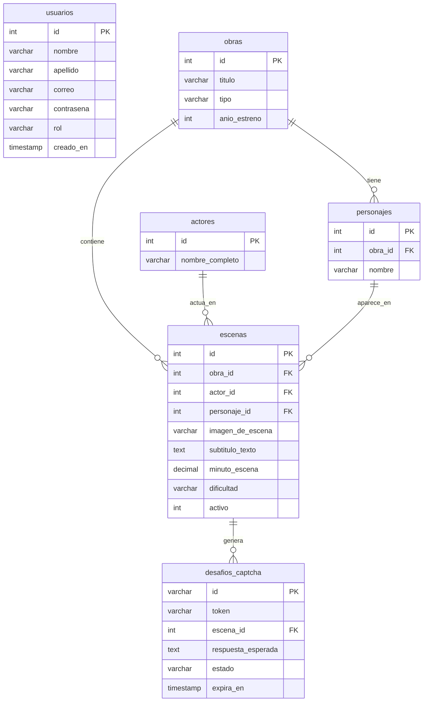

# API - Media (Text-Based CAPTCHA API)

[](https://nodejs.org/)
[](https://expressjs.com/)
[](https://www.mysql.com/)
[](https://vitest.dev/)
[](docs/openapi.yaml)

Este proyecto consiste en el desarrollo de una API diseñada para funcionar como un sistema de **CAPTCHA cultural basado en texto y reconocimiento audiovisual**. La API sirve escenas icónicas HD (1280×720) de series, películas y anime con subtítulos incrustados en la imagen, permitiendo validar la interacción humana mediante el contexto semántico de los elementos visuales y textuales expuestos.

> [!NOTE]
> **Estado del Proyecto:**
> - **Módulo de Usuarios y Autenticación RBAC (Activo):** Tokens JWT, encriptación bcrypt a 12 rondas, protección de titularidad (`propietarioOAdmin`), prevención de escalada de privilegios en registro público, validaciones RegEx y endpoints CRUD.
> - **Módulo de Escenas y Catálogo Multimedia (Activo):** Servicio de escenas HD con subtítulos incrustados en `/imagenes`, consulta de producciones (`/obras`) y catálogo protegido contra scraping de respuestas (`/escenas`).
> - **Motor CAPTCHA Cultural (Activo):** Generación de retos efímeros con tokens de un solo uso (`/captcha/nuevo`) y validación semántica con tolerancia a tildes, signos y faltas leves (`/captcha/validar`).
>
> 📖 Para una guía de arquitectura y referencia exhaustiva, consulta la [Documentación Técnica Detallada en docs/documentacion.md](docs/documentacion.md) y la especificación [OpenAPI 3.0 en docs/openapi.yaml](docs/openapi.yaml).

---

## 🚀 Características Principales

- **Seguridad en Contraseñas:** Encriptación y hasheo asíncrono con **`bcrypt`** (12 salt rounds), impidiendo el almacenamiento o exposición de contraseñas en texto plano.
- **Autenticación JWT y Autorización RBAC Estricta:** Tokens firmados (HS256) con control de acceso por roles (`cliente` y `admin`), validación de propietario en actualizaciones (`PUT /usuarios/:id`) y bloqueo de auto-asignación de rol `admin` en el registro público.
- **Protección Anti-Scraping en Catálogo:** Los endpoints públicos de catálogo (`/escenas`, `/obras/:id`) ocultan el campo `subtitulo_texto` a visitantes y clientes para impedir que bots extraigan las respuestas del CAPTCHA, habilitándolo únicamente ante tokens `admin`.
- **Validaciones Rigurosas:** Middleware de filtrado con expresiones regulares (RegEx), tipado estricto y validación de parámetros de consulta (`dificultad`, `obra_id`, IDs enteros positivos).
- **Base de Datos Normalizada:** Arquitectura relacional de 6 tablas con claves foráneas, restricciones de integridad referencial (`ON DELETE CASCADE` / `SET NULL`) e índices de búsqueda.
- **Diseño Arquitectónico Limpio:** Estructurado bajo el patrón Modelo-Controlador (MVC) en Node.js con Express 5 y ES Modules (`import`/`export`).
- **Suite de Pruebas Automatizadas:** **58 pruebas** unitarias y de integración desarrolladas con **Vitest** y **Supertest**.

---

## 📊 Diseño y Modelo de Datos Relacional (Persistencia)

La base de datos relacional `api_media_db` está estructurada en **6 tablas normalizadas** que separan las responsabilidades de identidad de usuarios y el catálogo audiovisual del CAPTCHA:



### Resumen de Entidades:

| Tabla | Propósito Principal | Claves Foráneas / Restricciones |
| :--- | :--- | :--- |
| `usuarios` | Cuentas, credenciales cifradas y roles RBAC (`cliente`, `admin`). | `correo` único, `contrasena` encriptada. |
| `obras` | Producciones audiovisuales (película, serie o anime) y año de estreno. | - |
| `actores` | Intérpretes de imagen real o actores de doblaje. | - |
| `personajes` | Personajes ficticios que intervienen en una obra. | FK -> `obras(id)` ON DELETE CASCADE. |
| `escenas` | Recurso multimedia base con imagen HD, subtítulo incrustado y minuto exacto. | FK -> `obras`, `actores`, `personajes`. |
| `desafios_captcha` | Retos efímeros de validación generados con fecha de expiración y token único. | FK -> `escenas(id)` ON DELETE CASCADE. |

---

## 🛠️ Puesta en Marcha / Instalación

### 1. Requisitos Previos
- **Node.js** (versión 18 o superior recomendada).
- **MySQL / MariaDB** (mediante XAMPP o servicio local en el puerto `3306`).

### 2. Configuración de Variables de Entorno
Copia el archivo `.env.example` a `.env` y configura tus accesos:
```env
PORT=3000

# Base de datos MySQL (XAMPP)
DB_HOST=localhost
DB_USER=root
DB_PASSWORD=
DB_NAME=api_media_db
DB_PORT=3306

# JSON Web Tokens (JWT)
JWT_SECRET=tu_clave_secreta_super_segura_aqui
JWT_EXPIRES_IN=2h
```

> [!TIP]
> Puedes generar una clave secreta segura desde la consola ejecutando:
> `node -e "import('crypto').then(c => console.log(c.randomBytes(48).toString('hex')))"`

### 3. Base de Datos
Importa el script SQL `database.sql` en tu gestor MySQL (phpMyAdmin o MySQL Workbench) para crear la base de datos `api_media_db` y cargar los datos iniciales. Si prefieres una guía gráfica paso a paso, consulta [IMPORTAR_BD.md](IMPORTAR_BD.md).

#### 🔑 Credenciales de Prueba Precargadas:
| Usuario / Rol | Correo Electrónico | Contraseña | Permisos |
| :--- | :--- | :--- | :--- |
| **Admin Sistema** | `admin@apimedia.com` | `Admin123*` | Control total (crear admins, ver `subtitulo_texto` en JSON, `PUT` global y `DELETE /usuarios/:id`) |
| **Leonardo Eckert** | `leonardo@ejemplo.com` | `Cliente123*` | Rutas protegidas estándar (`/perfil`, lectura, actualización propia) |
| **Carlos Gomez** | `carlos.gomez@ejemplo.com` | `ClaveSegura123` | Rutas protegidas estándar |
| **Mariana Lopez** | `mariana.lopez@ejemplo.com` | `Segura2026*` | Rutas protegidas estándar |

### 4. Instalación de dependencias y ejecución
```bash
# Instalar dependencias
npm install

# Modo desarrollo (con nodemon y recarga automática)
npm run dev

# Modo producción
npm start

# Ejecutar la suite de pruebas unitarias y de integración (58 tests con Vitest + Supertest)
npm test
```

### 5. Probar en el Navegador Web (Entorno Local)
Una vez iniciado el servidor con `npm run dev`, puedes interactuar con la API directamente desde tu navegador:

- **🌐 Web Demo Interactiva:** [http://localhost:3000/demo](http://localhost:3000/demo)  
  *Simulador visual del CAPTCHA en vivo con escenas HD y subtítulos incrustados, temporizador, panel de inicio de sesión con JWT y explorador de catálogo audiovisual.*
- **📖 Swagger UI Oficial:** [http://localhost:3000/api-docs](http://localhost:3000/api-docs)  
  *Documentación OpenAPI interactiva para probar solicitudes HTTP en tiempo real con el botón "Try it out".*

---

## 📖 Documentación de la API para Desarrolladores

### 🌐 Información General
- **URL Base local:** `http://localhost:3000`
- **Formato de intercambio:** `JSON`
- **Headers requeridos para peticiones con cuerpo (POST / PUT):**
  ```http
  Content-Type: application/json
  Accept: application/json
  ```
- **Header de Autenticación para endpoints protegidos:**
  ```http
  Authorization: Bearer <token_jwt>
  ```

---

### 🛡️ Reglas de Validación (RegEx y Tipos)

Al enviar datos a los endpoints que crean o modifican usuarios, el middleware [validar.js](src/middlewares/validar.js) aplica las siguientes reglas:

| Campo | Regla / Expresión Regular | Restricciones |
| :--- | :--- | :--- |
| `nombre` | `^[a-zA-ZáéíóúÁÉÍÓÚñÑüÜ\s]{2,50}$` | Obligatorio. Cadena de solo letras y espacios (2 a 50 caracteres). |
| `apellido` | `^[a-zA-ZáéíóúÁÉÍÓÚñÑüÜ\s]{2,50}$` | Opcional. Si se envía, solo letras y espacios (2-50 caracteres). |
| `correo` | `^[a-zA-Z0-9._%+-]+@[a-zA-Z0-9.-]+\.[a-zA-Z]{2,}$` | Obligatorio y único. Formato estándar de email (`usuario@dominio.com`). |
| `contrasena` | `^(?=.*[a-z])(?=.*[A-Z])(?=.*\d).{8,}$` | Obligatorio al registrar. Mínimo 8 caracteres, al menos 1 mayúscula, 1 minúscula y 1 número. |
| `rol` | `'cliente'` o `'admin'` | Opcional al registrar (por defecto `'cliente'`). Asignar `'admin'` exige token de un administrador. |

---

## 🔌 Resumen de Endpoints

### 👤 Módulo de Usuarios y Autenticación
| Método | Endpoint | Descripción | Acceso |
| :--- | :--- | :--- | :--- |
| `GET` | `/` | Comprobación de estado y bienvenida | Público |
| `POST` | `/usuarios` | Registro de nuevo usuario (`admin` requiere Bearer Admin) | Público / Admin |
| `POST` | `/usuarios/login` | Autenticación de credenciales y emisión de token JWT | Público |
| `GET` | `/usuarios/perfil` | Obtener perfil del usuario autenticado (desde el token) | Requiere Token (Bearer) |
| `GET` | `/usuarios` | Obtener listado de todos los usuarios registrados | Requiere Token (Bearer) |
| `GET` | `/usuarios/:id` | Obtener detalle de un usuario por su ID | Requiere Token (Bearer) |
| `PUT` | `/usuarios/:id` | Actualizar nombre, apellido o correo de un usuario | Requiere Token (Propietario o Admin) |
| `DELETE`| `/usuarios/:id` | Eliminar un usuario por su ID | Requiere Token (Solo Admin) |

### 🧩 Módulo del Motor CAPTCHA Cultural
| Método | Endpoint | Descripción | Acceso |
| :--- | :--- | :--- | :--- |
| `GET` | `/captcha/nuevo` | Genera un desafío efímero con imagen HD y token único | Público |
| `POST` | `/captcha/validar` | Valida la transcripción enviada por el usuario | Público |

### 🎬 Módulo de Catálogo Audiovisual y Archivos Estáticos
| Método | Endpoint | Descripción | Acceso |
| :--- | :--- | :--- | :--- |
| `GET` | `/escenas` | Listado de escenas y filtros (`?obra_id`, `?dificultad`). `subtitulo_texto` solo visible para Admin | Público / Admin |
| `GET` | `/escenas/:id` | Detalle de una escena por su ID (`subtitulo_texto` solo Admin) | Público / Admin |
| `GET` | `/obras` | Listado de películas, series y anime con cantidad de escenas | Público |
| `GET` | `/obras/:id` | Detalle de una obra con sus escenas asociadas (`subtitulo_texto` solo Admin) | Público / Admin |
| `GET` | `/imagenes/:archivo` | Servidor de archivos estáticos JPEG HD para imágenes de escenas | Público |

---

## 📡 Detalle de Endpoints

### 1. Mensaje de Bienvenida / Healthcheck
- **Método:** `GET`
- **Endpoint:** `/`
- **Respuesta Exitosa (200 OK):**
  ```json
  {
    "message": "Bienvenido a la API de Media!"
  }
  ```

---

### 2. Registrar Usuario
Crea una nueva cuenta de usuario. La contraseña es validada con RegEx y encriptada con **bcrypt** (12 rondas) antes de persistirse. El registro público asigna siempre el rol `cliente`; asignar `admin` requiere enviar un token Bearer perteneciente a un administrador.

- **Método:** `POST`
- **Endpoint:** `/usuarios`
- **Headers:** `Content-Type: application/json` *(+ `Authorization: Bearer <token_admin>` si se envía `"rol": "admin"`)*
- **Cuerpo de la petición (JSON):**
  ```json
  {
    "nombre": "Carlos",
    "apellido": "Gomez",
    "correo": "carlos.gomez@ejemplo.com",
    "contrasena": "ClaveSegura123",
    "rol": "cliente"
  }
  ```

- **Respuesta Exitosa (201 Created):**
  ```json
  {
    "message": "Usuario creado con éxito",
    "usuario": {
      "id": 2,
      "nombre": "Carlos",
      "apellido": "Gomez",
      "correo": "carlos.gomez@ejemplo.com",
      "rol": "cliente",
      "creado_en": "2026-10-20T22:30:00.000Z"
    }
  }
  ```

- **Respuestas de Error:**
  - **400 Bad Request** (Faltan campos obligatorios, rol fuera de dominio o falla validación RegEx):
    ```json
    { "message": "Nombre, correo y contraseña son obligatorios" }
    ```
    ```json
    { "message": "La contraseña debe tener al menos 8 caracteres, incluir al menos una letra mayúscula, una minúscula y un número" }
    ```
    ```json
    { "message": "El rol proporcionado no es válido. Debe ser 'cliente' o 'admin'" }
    ```
  - **403 Forbidden** (Intento de auto-asignar rol `'admin'` sin token de administrador):
    ```json
    { "message": "Acceso denegado: solo un administrador autenticado puede asignar el rol 'admin'" }
    ```
  - **409 Conflict** (El correo ya está registrado):
    ```json
    { "message": "El correo ya se encuentra registrado" }
    ```

---

### 3. Iniciar Sesión (Login)
Autentica las credenciales comparando la contraseña enviada contra el hash bcrypt. Emite un token JWT con vigencia de 2 horas.

- **Método:** `POST`
- **Endpoint:** `/usuarios/login`
- **Headers:** `Content-Type: application/json`
- **Cuerpo de la petición (JSON):**
  ```json
  {
    "correo": "carlos.gomez@ejemplo.com",
    "contrasena": "ClaveSegura123"
  }
  ```

- **Respuesta Exitosa (200 OK):**
  ```json
  {
    "message": "Inicio de sesión exitoso",
    "token": "eyJhbGciOiJIUzI1NiIsInR5cCI6IkpXVCJ9...",
    "usuario": {
      "id": 2,
      "nombre": "Carlos",
      "apellido": "Gomez",
      "correo": "carlos.gomez@ejemplo.com",
      "rol": "cliente",
      "creado_en": "2026-10-20T22:30:00.000Z",
      "actualizado_en": "2026-10-20T22:30:00.000Z"
    }
  }
  ```

- **Respuestas de Error:**
  - **400 Bad Request**: `{ "message": "Correo y contraseña son obligatorios" }`
  - **401 Unauthorized**: `{ "message": "Credenciales inválidas" }`

---

### 4. Obtener Perfil del Usuario Autenticado
Retorna los datos del usuario en sesión a partir de la identidad codificada en su token JWT.

- **Método:** `GET`
- **Endpoint:** `/usuarios/perfil`
- **Headers:** `Authorization: Bearer <token_jwt>`
- **Respuesta Exitosa (200 OK):**
  ```json
  {
    "id": 2,
    "nombre": "Carlos",
    "apellido": "Gomez",
    "correo": "carlos.gomez@ejemplo.com",
    "rol": "cliente",
    "creado_en": "2026-10-20T22:30:00.000Z"
  }
  ```
- **Respuestas de Error:**
  - **401 Unauthorized**: Token ausente, formato inválido o expirado.
  - **403 Forbidden**: `{ "message": "Token inválido o alterado" }`.

---

### 5. Obtener Todos los Usuarios
Recupera el listado completo de los usuarios dados de alta en el sistema.

- **Método:** `GET`
- **Endpoint:** `/usuarios`
- **Headers:** `Authorization: Bearer <token_jwt>`
- **Respuesta Exitosa (200 OK):** Arreglo JSON de objetos usuario (sin contraseñas).

---

### 6. Obtener Usuario por ID
Recupera los datos de un usuario específico a través de su identificador numérico positivo.

- **Método:** `GET`
- **Endpoint:** `/usuarios/:id`
- **Headers:** `Authorization: Bearer <token_jwt>`
- **Respuestas de Error:**
  - **400 Bad Request**: `{ "message": "El ID proporcionado debe ser un número válido" }`
  - **404 Not Found**: `{ "message": "Usuario no encontrado" }`

---

### 7. Actualizar Usuario
Modifica los datos generales (`nombre`, `apellido`, `correo`) de un usuario existente. Protegido contra BOLA/IDOR: solo el propio titular del `:id` o un usuario con rol `admin` puede ejecutar la actualización.

- **Método:** `PUT`
- **Endpoint:** `/usuarios/:id`
- **Headers:**
  ```http
  Content-Type: application/json
  Authorization: Bearer <token_jwt>
  ```
- **Cuerpo de la petición (JSON):**
  ```json
  {
    "nombre": "Carlos Actualizado",
    "apellido": "Gomez Perez"
  }
  ```
- **Respuesta Exitosa (200 OK):**
  ```json
  {
    "message": "Usuario actualizado correctamente",
    "usuario": {
      "id": 2,
      "nombre": "Carlos Actualizado",
      "apellido": "Gomez Perez",
      "correo": "carlos.gomez@ejemplo.com",
      "rol": "cliente",
      "creado_en": "2026-10-20T22:30:00.000Z"
    }
  }
  ```
- **Respuestas de Error:**
  - **400 Bad Request**: `{ "message": "Debe enviar al menos un campo para actualizar" }`
  - **403 Forbidden**: `{ "message": "Acceso denegado: solo puedes modificar tu propia cuenta o contar con privilegios de administrador" }`
  - **404 Not Found**: `{ "message": "Usuario no encontrado" }`
  - **409 Conflict**: `{ "message": "El nuevo correo ya está en uso por otro usuario" }`

---

### 8. Eliminar Usuario
Da de baja a un usuario de la base de datos. Requiere privilegios estrictos de administrador (`rol: admin`).

- **Método:** `DELETE`
- **Endpoint:** `/usuarios/:id`
- **Headers:** `Authorization: Bearer <token_admin>`
- **Respuesta Exitosa (200 OK):** Objeto con `message` y datos del usuario eliminado.
- **Respuestas de Error:**
  - **403 Forbidden**: `{ "message": "Acceso denegado: se requieren privilegios de administrador" }`
  - **404 Not Found**: `{ "message": "Usuario no encontrado" }`

---

### 9. Generar Desafío CAPTCHA
Selecciona aleatoriamente una escena activa de la base de datos, crea un reto efímero con vigencia de 10 minutos en `desafios_captcha` y entrega al cliente la URL de la imagen HD con subtítulo incrustado y un token seguro. El texto plano del subtítulo **nunca** se envía al cliente.

- **Método:** `GET`
- **Endpoint:** `/captcha/nuevo`
- **Parámetros de Consulta (Opcionales):**
  - `dificultad`: Filtrar por nivel (`facil`, `medio`, `dificil`).
- **Respuesta Exitosa (201 Created):**
  ```json
  {
    "message": "Desafío CAPTCHA generado con éxito",
    "desafio_id": "a1b2c3d4-e5f6-7890-abcd-ef1234567890",
    "token": "tok_9f8a7b6c5d4e3f2a1b0c8d7e6f5a4b3c",
    "imagen_url": "http://localhost:3000/imagenes/matrix_pastilla_azul_roja.jpg",
    "dificultad": "medio",
    "obra": "The Matrix",
    "expira_en": "2026-10-20T22:50:00.000Z",
    "instrucciones": "Escribe el texto del subtítulo visible en la imagen para validar que eres humano."
  }
  ```

---

### 10. Validar Desafío CAPTCHA
Recibe el token del reto y la transcripción ingresada por el usuario. Aplica limpieza del token, normalización de texto (eliminando acentos, mayúsculas, signos de puntuación y espacios extras) y similitud por distancia de Levenshtein (`>= 85%`). Si la respuesta es correcta, invalida el reto marcándolo como `resuelto` (un solo uso).

- **Método:** `POST`
- **Endpoint:** `/captcha/validar`
- **Headers:** `Content-Type: application/json`
- **Cuerpo de la Petición (JSON):**
  ```json
  {
    "token": "tok_9f8a7b6c5d4e3f2a1b0c8d7e6f5a4b3c",
    "respuesta": "toma la pastilla azul y el fin de la historia toma la pastilla roja y te quedas en el pais de las maravillas"
  }
  ```
- **Respuesta Exitosa (200 OK):**
  ```json
  {
    "valido": true,
    "message": "Verificación humana exitosa",
    "desafio_id": "a1b2c3d4-e5f6-7890-abcd-ef1234567890",
    "token": "tok_9f8a7b6c5d4e3f2a1b0c8d7e6f5a4b3c"
  }
  ```
- **Respuestas de Error:**
  - **400 Bad Request** (Respuesta incorrecta, desafío expirado o ya resuelto).
  - **404 Not Found**: `{ "message": "Desafío no encontrado o token inválido" }`.

---

### 11. Listar Catálogo de Escenas
Recupera el listado de escenas audiovisuales con sus respectivos actores, personajes y obras. Para evitar que bots consulten este endpoint y resuelvan el CAPTCHA automáticamente, el atributo `subtitulo_texto` se omite en consultas públicas y solo se incluye si se envía un token JWT con rol `admin`.

- **Método:** `GET`
- **Endpoint:** `/escenas`
- **Parámetros de Consulta (Opcionales):** `?obra_id=1&dificultad=facil`
- **Respuesta Exitosa Pública (200 OK):**
  ```json
  [
    {
      "id": 1,
      "imagen_de_escena": "matrix_pastilla_azul_roja.jpg",
      "imagen_url": "http://localhost:3000/imagenes/matrix_pastilla_azul_roja.jpg",
      "minuto_escena": 28.45,
      "dificultad": "medio",
      "obra_titulo": "The Matrix",
      "actor_nombre": "Laurence Fishburne",
      "personaje_nombre": "Morpheus"
    }
  ]
  ```

---

### 12. Listar Obras Audiovisuales
Obtiene la lista de películas, series y animes registrados, incluyendo el total de escenas asociadas.

- **Método:** `GET`
- **Endpoint:** `/obras`
- **Respuesta Exitosa (200 OK):**
  ```json
  [
    {
      "id": 1,
      "titulo": "The Matrix",
      "tipo": "pelicula",
      "anio_estreno": 1999,
      "total_escenas": 1
    }
  ]
  ```

---

## 💻 Ejemplos de Consumo Práctico

### Ejemplo 1: JavaScript Moderno (`fetch`)

#### Iniciar Sesión y Consumir Endpoint Protegido:
```javascript
async function loginYPerfil() {
  try {
    const resLogin = await fetch("http://localhost:3000/usuarios/login", {
      method: "POST",
      headers: { "Content-Type": "application/json" },
      body: JSON.stringify({
        correo: "carlos.gomez@ejemplo.com",
        contrasena: "ClaveSegura123",
      }),
    });

    const dataLogin = await resLogin.json();
    if (!resLogin.ok) throw new Error(dataLogin.message);

    const token = dataLogin.token;
    console.log("Token obtenido con éxito:", token);

    const resPerfil = await fetch("http://localhost:3000/usuarios/perfil", {
      method: "GET",
      headers: { Authorization: `Bearer ${token}` },
    });

    const miPerfil = await resPerfil.json();
    console.log("Perfil del usuario autenticado:", miPerfil);
  } catch (error) {
    console.error("Error en la operación:", error.message);
  }
}

loginYPerfil();
```

#### Flujo Completo del Motor CAPTCHA (Solicitar y Resolver Desafío):
```javascript
async function flujoCaptcha() {
  try {
    const resReto = await fetch("http://localhost:3000/captcha/nuevo?dificultad=facil");
    const reto = await resReto.json();
    console.log("Desafío recibido:", reto);
    console.log("Cargar imagen para el usuario:", reto.imagen_url);

    // El usuario visualiza la escena HD e ingresa el subtítulo leído
    const textoUsuario = "No, yo soy tu padre";

    const resValidacion = await fetch("http://localhost:3000/captcha/validar", {
      method: "POST",
      headers: { "Content-Type": "application/json" },
      body: JSON.stringify({
        token: reto.token,
        respuesta: textoUsuario,
      }),
    });

    const resultado = await resValidacion.json();
    if (resultado.valido) {
      console.log("¡Verificación humana exitosa!", resultado);
    } else {
      console.warn("Validación fallida:", resultado.message);
    }
  } catch (error) {
    console.error("Error en flujo CAPTCHA:", error.message);
  }
}

flujoCaptcha();
```

---

### Ejemplo 2: Probar con `cURL` desde la Terminal

#### 1. Solicitar Desafío CAPTCHA:
```bash
curl -X GET http://localhost:3000/captcha/nuevo
```

#### 2. Validar Desafío CAPTCHA:
```bash
curl -X POST http://localhost:3000/captcha/validar \
  -H "Content-Type: application/json" \
  -d "{\"token\":\"tok_TOKEN_OBTENIDO\",\"respuesta\":\"texto del subtitulo\"}"
```

#### 3. Consultar Catálogo de Escenas:
```bash
curl -X GET http://localhost:3000/escenas
```

#### 4. Registrar Usuario:
```bash
curl -X POST http://localhost:3000/usuarios \
  -H "Content-Type: application/json" \
  -d "{\"nombre\":\"Mariana\",\"apellido\":\"Lopez\",\"correo\":\"mariana@ejemplo.com\",\"contrasena\":\"Segura2026*\"}"
```

#### 5. Iniciar Sesión (Obtener JWT):
```bash
curl -X POST http://localhost:3000/usuarios/login \
  -H "Content-Type: application/json" \
  -d "{\"correo\":\"mariana@ejemplo.com\",\"contrasena\":\"Segura2026*\"}"
```

#### 6. Consultar Perfil Propio:
```bash
curl -X GET http://localhost:3000/usuarios/perfil \
  -H "Authorization: Bearer <TOKEN_OBTENIDO>"
```

#### 7. Eliminar Usuario (Requiere Token de Administrador):
```bash
curl -X DELETE http://localhost:3000/usuarios/2 \
  -H "Authorization: Bearer <TOKEN_ADMIN>"
```

---

## 🚦 Códigos de Estado HTTP Utilizados

- `200 OK`: Operación exitosa (lectura, modificación, validación CAPTCHA o eliminación completada).
- `201 Created`: Recurso creado exitosamente (registro de usuario o nuevo desafío CAPTCHA).
- `400 Bad Request`: Parámetros faltantes, dificultad/rol inválido, reto CAPTCHA fallido/vencido o datos que no cumplen RegEx.
- `401 Unauthorized`: Fallo de autenticación en login, token ausente, formato inválido o expirado.
- `403 Forbidden`: Acceso denegado (token adulterado, intento de modificar cuenta ajena o privilegios insuficientes).
- `404 Not Found`: El recurso, desafío o ruta especificada no existe.
- `409 Conflict`: Conflicto de unicidad en la base de datos (ej. correo ya registrado).
- `500 Internal Server Error`: Error interno imprevisto en el servidor.
