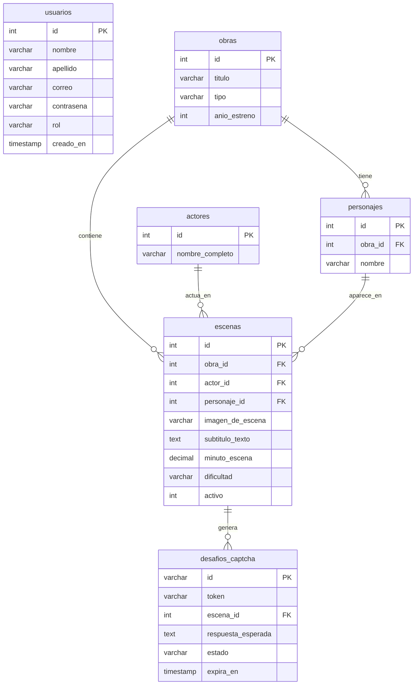

# API - Media (Text-Based CAPTCHA API)

[](https://nodejs.org/)
[](https://expressjs.com/)
[](https://www.mysql.com/)
[](https://vitest.dev/)
[](docs/openapi.yaml)

Este proyecto consiste en el desarrollo de una API diseñada para funcionar principalmente como un sistema de **CAPTCHA cultural basado en texto y reconocimiento audiovisual**. La API se encarga de servir escenas icónicas de series, películas y anime con subtítulos incrustados en la imagen, permitiendo validar la interacción humana mediante el contexto semántico de los elementos visuales y textuales expuestos.

> [!NOTE]
> **Estado y Fases del Proyecto:**
> - **Fase 1 (Activa y en Producción):** Módulo completo de **Gestión de Usuarios, Autenticación y Autorización RBAC** (Tokens JWT, encriptación bcrypt a 12 rondas, validaciones RegEx y endpoints CRUD).
> - **Fase 2 (En desarrollo):** Motor de generación y verificación de desafíos CAPTCHA (`/captcha`, `/escenas`, `/obras`). Las tablas de la base de datos ya están creadas y sembradas en `database.sql`.
>
> 📖 Para una guía de arquitectura y referencia exhaustiva, consulta la [Documentación Técnica Detallada en docs/documentacion.md](docs/documentacion.md) y la especificación [OpenAPI 3.0 en docs/openapi.yaml](docs/openapi.yaml).

---

## 🚀 Características Principales

- **Seguridad en Contraseñas:** Encriptación y hasheo asíncrono con **`bcrypt`** (12 salt rounds), impidiendo el almacenamiento o exposición de contraseñas en texto plano.
- **Autenticación y Autorización con JWT:** Tokens firmados (JSON Web Tokens con HS256) con expiración configurable y control de acceso basado en roles (`cliente` y `admin`).
- **Validaciones Rigurosas:** Middleware de filtrado con expresiones regulares (RegEx) para nombres, apellidos, correos estándar y contraseñas seguras, además de validación de dominios de roles.
- **Base de Datos Normalizada:** Arquitectura relacional de 6 tablas con claves foráneas, restricciones de integridad referencial (`ON DELETE CASCADE` / `SET NULL`) e índices de búsqueda.
- **Diseño Arquitectónico Limpio:** Estructurado bajo el patrón Modelo-Controlador (MVC) en Node.js con Express 5 y ES Modules (`import`/`export`).
- **Suite de Pruebas Automatizadas:** 31 pruebas unitarias y de integración desarrolladas con **Vitest** y **Supertest**.

---

## 📊 Diseño y Modelo de Datos Relacional (Persistencia)

La base de datos relacional `api_media_db` está estructurada en **6 tablas normalizadas** que separan las responsabilidades de identidad de usuarios y el catálogo audiovisual del CAPTCHA:



### Resumen de Entidades:

| Tabla | Propósito Principal | Claves Foráneas / Restricciones |
| :--- | :--- | :--- |
| `usuarios` | Cuentas, credenciales cifradas y roles RBAC (`cliente`, `admin`). | `correo` único, `contrasena` encriptada. |
| `obras` | Producciones audiovisuales (película, serie o anime) y año de estreno. | - |
| `actores` | Intérpretes de imagen real o actores de doblaje. | - |
| `personajes` | Personajes ficticios que intervienen en una obra. | FK -> `obras(id)` ON DELETE CASCADE. |
| `escenas` | Recurso multimedia base con imagen, subtítulo incrustado y minuto exacto. | FK -> `obras`, `actores`, `personajes`. |
| `desafios_captcha` | Retos efímeros de validación generados con fecha de expiración y token único. | FK -> `escenas(id)` ON DELETE CASCADE. |

---

## 🛠️ Puesta en Marcha / Instalación

### 1. Requisitos Previos
- **Node.js** (versión 18 o superior recomendada).
- **MySQL / MariaDB** (mediante XAMPP o servicio local en el puerto `3306`).

### 2. Configuración de Variables de Entorno
Copia el archivo `.env.example` a `.env` y configura tus accesos:
```env
PORT=3000

# Base de datos MySQL (XAMPP)
DB_HOST=localhost
DB_USER=root
DB_PASSWORD=
DB_NAME=api_media_db
DB_PORT=3306

# JSON Web Tokens (JWT)
JWT_SECRET=tu_clave_secreta_super_segura_aqui
JWT_EXPIRES_IN=2h
```

> [!TIP]
> Puedes generar una clave secreta segura desde la consola ejecutando:
> `node -e "import('crypto').then(c => console.log(c.randomBytes(48).toString('hex')))"`

### 3. Base de Datos
Importa el script SQL `database.sql` en tu gestor MySQL (phpMyAdmin o MySQL Workbench) para crear la base de datos `api_media_db` y cargar los datos iniciales. Si prefieres una guía gráfica paso a paso, consulta [IMPORTAR_BD.md](IMPORTAR_BD.md).

#### 🔑 Credenciales de Prueba Precargadas:
| Usuario / Rol | Correo Electrónico | Contraseña | Permisos |
| :--- | :--- | :--- | :--- |
| **Admin Sistema** | `admin@apimedia.com` | `Admin123*` | Control total (incluye `DELETE /usuarios/:id`) |
| **Leonardo Eckert** | `leonardo@ejemplo.com` | `Cliente123*` | Rutas protegidas estándar (`/perfil`, lectura, actualización) |
| **Carlos Gomez** | `carlos.gomez@ejemplo.com` | `ClaveSegura123` | Rutas protegidas estándar |
| **Mariana Lopez** | `mariana.lopez@ejemplo.com` | `Segura2026*` | Rutas protegidas estándar |

### 4. Instalación de dependencias y ejecución
```bash
# Instalar dependencias
npm install

# Modo desarrollo (con nodemon y recarga automática)
npm run dev

# Modo producción
npm start

# Ejecutar la suite de pruebas unitarias y de integración (Vitest + Supertest)
npm test
```

---

## 📖 Documentación de la API para Desarrolladores

### 🌐 Información General
- **URL Base local:** `http://localhost:3000`
- **Formato de intercambio:** `JSON`
- **Headers requeridos para peticiones con cuerpo (POST / PUT):**
  ```http
  Content-Type: application/json
  Accept: application/json
  ```
- **Header de Autenticación para endpoints protegidos:**
  ```http
  Authorization: Bearer <token_jwt>
  ```

---

### 🛡️ Reglas de Validación (RegEx y Tipos)

Al enviar datos a los endpoints que crean o modifican usuarios, el middleware [validar.js](src/middlewares/validar.js) aplica las siguientes reglas:

| Campo | Regla / Expresión Regular | Restricciones |
| :--- | :--- | :--- |
| `nombre` | `^[a-zA-ZáéíóúÁÉÍÓÚñÑüÜ\s]{2,50}$` | Obligatorio. Solo letras y espacios. Entre 2 y 50 caracteres. |
| `apellido` | `^[a-zA-ZáéíóúÁÉÍÓÚñÑüÜ\s]{2,50}$` | Opcional. Si se envía, solo letras y espacios (2-50 caracteres). |
| `correo` | `^[a-zA-Z0-9._%+-]+@[a-zA-Z0-9.-]+\.[a-zA-Z]{2,}$` | Obligatorio y único. Formato estándar de email (`usuario@dominio.com`). |
| `contrasena` | `^(?=.*[a-z])(?=.*[A-Z])(?=.*\d).{8,}$` | Obligatorio al registrar. Mínimo 8 caracteres, al menos 1 mayúscula, 1 minúscula y 1 número. |
| `rol` | `'cliente'` o `'admin'` | Opcional al registrar (por defecto `'cliente'`). Solo admite estos dos valores. |

---

## 🔌 Resumen de Endpoints

| Método | Endpoint | Descripción | Acceso |
| :--- | :--- | :--- | :--- |
| `GET` | `/` | Comprobación de estado y bienvenida | Público |
| `POST` | `/usuarios` | Registro de un nuevo usuario | Público |
| `POST` | `/usuarios/login` | Autenticación de credenciales y emisión de token JWT | Público |
| `GET` | `/usuarios/perfil` | Obtener perfil del usuario autenticado (desde el token) | Requiere Token (Bearer) |
| `GET` | `/usuarios` | Obtener listado de todos los usuarios registrados | Requiere Token (Bearer) |
| `GET` | `/usuarios/:id` | Obtener detalle de un usuario por su ID | Requiere Token (Bearer) |
| `PUT` | `/usuarios/:id` | Actualizar nombre, apellido o correo de un usuario | Requiere Token (Bearer) |
| `DELETE`| `/usuarios/:id` | Eliminar un usuario por su ID | Requiere Token (Solo Admin) |

---

## 📡 Detalle de Endpoints

### 1. Mensaje de Bienvenida / Healthcheck
- **Método:** `GET`
- **Endpoint:** `/`
- **Respuesta Exitosa (200 OK):**
  ```json
  {
    "message": "Bienvenido a la API de Media!"
  }
  ```

---

### 2. Registrar Usuario
Crea una nueva cuenta de usuario. La contraseña es validada con RegEx y encriptada con **bcrypt** (12 rondas) antes de persistirse.

- **Método:** `POST`
- **Endpoint:** `/usuarios`
- **Headers:** `Content-Type: application/json`
- **Cuerpo de la petición (JSON):**
  ```json
  {
    "nombre": "Carlos",
    "apellido": "Gomez",
    "correo": "carlos.gomez@ejemplo.com",
    "contrasena": "ClaveSegura123",
    "rol": "cliente"
  }
  ```
  *(Nota: `rol` y `apellido` son opcionales. `rol` por defecto es `"cliente"`).*

- **Respuesta Exitosa (201 Created):**
  ```json
  {
    "message": "Usuario creado con éxito",
    "usuario": {
      "id": 2,
      "nombre": "Carlos",
      "apellido": "Gomez",
      "correo": "carlos.gomez@ejemplo.com",
      "rol": "cliente",
      "creado_en": "2026-10-20T22:30:00.000Z"
    }
  }
  ```

- **Respuestas de Error:**
  - **400 Bad Request** (Faltan campos obligatorios o falla validación RegEx):
    ```json
    { "message": "Nombre, correo y contraseña son obligatorios" }
    ```
    ```json
    { "message": "La contraseña debe tener al menos 8 caracteres, incluir al menos una letra mayúscula, una minúscula y un número" }
    ```
    ```json
    { "message": "El rol proporcionado no es válido. Debe ser 'cliente' o 'admin'" }
    ```
  - **409 Conflict** (El correo ya está registrado):
    ```json
    { "message": "El correo ya se encuentra registrado" }
    ```

---

### 3. Iniciar Sesión (Login)
Autentica las credenciales comparando la contraseña enviada contra el hash bcrypt. Emite un token JWT con vigencia de 2 horas.

- **Método:** `POST`
- **Endpoint:** `/usuarios/login`
- **Headers:** `Content-Type: application/json`
- **Cuerpo de la petición (JSON):**
  ```json
  {
    "correo": "carlos.gomez@ejemplo.com",
    "contrasena": "ClaveSegura123"
  }
  ```

- **Respuesta Exitosa (200 OK):**
  ```json
  {
    "message": "Inicio de sesión exitoso",
    "token": "eyJhbGciOiJIUzI1NiIsInR5cCI6IkpXVCJ9...",
    "usuario": {
      "id": 2,
      "nombre": "Carlos",
      "apellido": "Gomez",
      "correo": "carlos.gomez@ejemplo.com",
      "rol": "cliente",
      "creado_en": "2026-10-20T22:30:00.000Z",
      "actualizado_en": "2026-10-20T22:30:00.000Z"
    }
  }
  ```

- **Respuestas de Error:**
  - **400 Bad Request** (Campos vacíos o formato de correo inválido):
    ```json
    { "message": "Correo y contraseña son obligatorios" }
    ```
  - **401 Unauthorized** (Contraseña incorrecta o correo inexistente):
    ```json
    { "message": "Credenciales inválidas" }
    ```

---

### 4. Obtener Perfil del Usuario Autenticado
Retorna los datos del usuario en sesión a partir de la identidad codificada en su token JWT.

- **Método:** `GET`
- **Endpoint:** `/usuarios/perfil`
- **Headers:** `Authorization: Bearer <token_jwt>`
- **Respuesta Exitosa (200 OK):**
  ```json
  {
    "id": 2,
    "nombre": "Carlos",
    "apellido": "Gomez",
    "correo": "carlos.gomez@ejemplo.com",
    "rol": "cliente",
    "creado_en": "2026-10-20T22:30:00.000Z"
  }
  ```
- **Respuestas de Error:**
  - **401 Unauthorized** (Token ausente):
    ```json
    { "message": "Token de autenticación no proporcionado" }
    ```
  - **401 Unauthorized** (Prefijo `Bearer` ausente o formato erróneo):
    ```json
    { "message": "Formato de token inválido. Formato esperado: Bearer <token>" }
    ```
  - **401 Unauthorized** (Token expirado):
    ```json
    { "message": "Token expirado. Inicie sesión nuevamente" }
    ```
  - **403 Forbidden** (Firma inválida o token manipulado):
    ```json
    { "message": "Token inválido o alterado" }
    ```

---

### 5. Obtener Todos los Usuarios
Recupera el listado completo de los usuarios dados de alta en el sistema.

- **Método:** `GET`
- **Endpoint:** `/usuarios`
- **Headers:** `Authorization: Bearer <token_jwt>`
- **Respuesta Exitosa (200 OK):**
  ```json
  [
    {
      "id": 1,
      "nombre": "Admin",
      "apellido": "Sistema",
      "correo": "admin@apimedia.com",
      "rol": "admin",
      "creado_en": "2026-10-20T20:00:00.000Z"
    },
    {
      "id": 2,
      "nombre": "Carlos",
      "apellido": "Gomez",
      "correo": "carlos.gomez@ejemplo.com",
      "rol": "cliente",
      "creado_en": "2026-10-20T22:30:00.000Z"
    }
  ]
  ```

---

### 6. Obtener Usuario por ID
Recupera los datos de un usuario en específico a través de su identificador numérico.

- **Método:** `GET`
- **Endpoint:** `/usuarios/:id`
- **Headers:** `Authorization: Bearer <token_jwt>`
- **Parámetros de Ruta:** `id` *(número entero obligatorio)*.
- **Respuesta Exitosa (200 OK):**
  ```json
  {
    "id": 2,
    "nombre": "Carlos",
    "apellido": "Gomez",
    "correo": "carlos.gomez@ejemplo.com",
    "rol": "cliente",
    "creado_en": "2026-10-20T22:30:00.000Z"
  }
  ```
- **Respuestas de Error:**
  - **400 Bad Request**: `{ "message": "El ID proporcionado debe ser un número válido" }`
  - **404 Not Found**: `{ "message": "Usuario no encontrado" }`

---

### 7. Actualizar Usuario
Modifica los datos generales (`nombre`, `apellido`, `correo`) de un usuario existente. Solo es necesario enviar los campos que se deseen cambiar.

- **Método:** `PUT`
- **Endpoint:** `/usuarios/:id`
- **Headers:**
  ```http
  Content-Type: application/json
  Authorization: Bearer <token_jwt>
  ```
- **Cuerpo de la petición (JSON):**
  ```json
  {
    "nombre": "Carlos Actualizado",
    "apellido": "Gomez Perez"
  }
  ```
- **Respuesta Exitosa (200 OK):**
  ```json
  {
    "message": "Usuario actualizado correctamente",
    "usuario": {
      "id": 2,
      "nombre": "Carlos Actualizado",
      "apellido": "Gomez Perez",
      "correo": "carlos.gomez@ejemplo.com",
      "rol": "cliente",
      "creado_en": "2026-10-20T22:30:00.000Z"
    }
  }
  ```
- **Respuestas de Error:**
  - **400 Bad Request**: `{ "message": "Debe enviar al menos un campo para actualizar" }`
  - **404 Not Found**: `{ "message": "Usuario no encontrado" }`
  - **409 Conflict**: `{ "message": "El nuevo correo ya está en uso por otro usuario" }`

---

### 8. Eliminar Usuario
Da de baja a un usuario de la base de datos. Requiere privilegios estrictos de administrador (`rol: admin`).

- **Método:** `DELETE`
- **Endpoint:** `/usuarios/:id`
- **Headers:** `Authorization: Bearer <token_admin>`
- **Respuesta Exitosa (200 OK):**
  ```json
  {
    "message": "Usuario eliminado correctamente",
    "usuario": {
      "id": 2,
      "nombre": "Carlos Actualizado",
      "apellido": "Gomez Perez",
      "correo": "carlos.gomez@ejemplo.com",
      "rol": "cliente",
      "creado_en": "2026-10-20T22:30:00.000Z"
    }
  }
  ```
- **Respuestas de Error:**
  - **403 Forbidden** (Usuario sin rol 'admin'):
    ```json
    { "message": "Acceso denegado: se requieren privilegios de administrador" }
    ```
  - **404 Not Found**:
    ```json
    { "message": "Usuario no encontrado" }
    ```

---

## 💻 Ejemplos de Consumo Práctico

### Ejemplo 1: JavaScript Moderno (`fetch`)

#### Iniciar Sesión y Consumir Endpoint Protegido:
```javascript
// 1. Iniciar sesión y obtener token JWT
async function loginYPerfil() {
  try {
    const resLogin = await fetch("http://localhost:3000/usuarios/login", {
      method: "POST",
      headers: { "Content-Type": "application/json" },
      body: JSON.stringify({
        correo: "carlos.gomez@ejemplo.com",
        contrasena: "ClaveSegura123",
      }),
    });

    const dataLogin = await resLogin.json();
    if (!resLogin.ok) throw new Error(dataLogin.message);

    const token = dataLogin.token;
    console.log("Token obtenido con éxito:", token);

    // 2. Consultar perfil con el Bearer token
    const resPerfil = await fetch("http://localhost:3000/usuarios/perfil", {
      method: "GET",
      headers: { Authorization: `Bearer ${token}` },
    });

    const miPerfil = await resPerfil.json();
    console.log("Perfil del usuario autenticado:", miPerfil);
  } catch (error) {
    console.error("Error en la operación:", error.message);
  }
}

loginYPerfil();
```

---

### Ejemplo 2: Probar con `cURL` desde la Terminal

#### 1. Registrar Usuario:
```bash
curl -X POST http://localhost:3000/usuarios \
  -H "Content-Type: application/json" \
  -d "{\"nombre\":\"Mariana\",\"apellido\":\"Lopez\",\"correo\":\"mariana@ejemplo.com\",\"contrasena\":\"Segura2026*\"}"
```

#### 2. Iniciar Sesión (Obtener JWT):
```bash
curl -X POST http://localhost:3000/usuarios/login \
  -H "Content-Type: application/json" \
  -d "{\"correo\":\"mariana@ejemplo.com\",\"contrasena\":\"Segura2026*\"}"
```

#### 3. Consultar Perfil Propio:
```bash
curl -X GET http://localhost:3000/usuarios/perfil \
  -H "Authorization: Bearer <TOKEN_OBTENIDO>"
```

#### 4. Eliminar Usuario (Requiere Token de Administrador):
```bash
curl -X DELETE http://localhost:3000/usuarios/2 \
  -H "Authorization: Bearer <TOKEN_ADMIN>"
```

---

## 🚦 Códigos de Estado HTTP Utilizados

- `200 OK`: Operación exitosa (lectura, modificación o eliminación completada).
- `201 Created`: Recurso creado exitosamente (registro de usuario).
- `400 Bad Request`: Parámetros faltantes, rol inválido o datos que no cumplen el formato RegEx.
- `401 Unauthorized`: Fallo de autenticación en login, token ausente, formato inválido o expirado.
- `403 Forbidden`: Acceso denegado (token adulterado o rol insuficiente como en eliminación de usuarios).
- `404 Not Found`: El recurso o ID especificado no existe.
- `409 Conflict`: Conflicto de unicidad en la base de datos (ej. correo ya registrado).
- `500 Internal Server Error`: Error interno imprevisto en el servidor.
