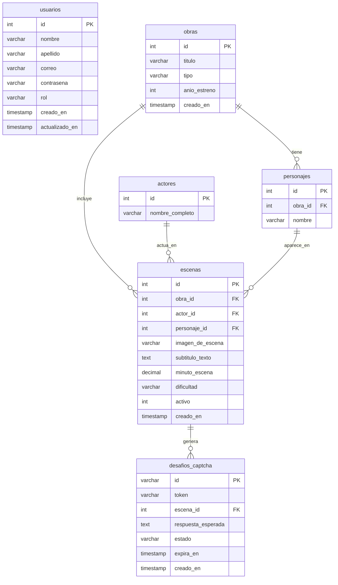

# 📚 Documentación Técnica Integral - API Media

> **Versión de la API:** 1.0.0  
> **Entorno de Ejecución:** Node.js (ES Modules) + Express 5  
> **Base de Datos:** MySQL 8.0+ / MariaDB (vía `mysql2/promise`)  
> **Seguridad:** Encriptación bcrypt (12 salt rounds) + Tokens JWT (HS256) + Control de Acceso Basado en Roles (RBAC) y Titularidad (Anti-BOLA)  

---

## 📑 Tabla de Contenidos

1. [Visión General del Proyecto](#-1-visión-general-del-proyecto)
2. [Arquitectura del Software](#-2-arquitectura-del-software)
3. [Modelo de Datos y Base de Datos Relacional](#-3-modelo-de-datos-y-base-de-datos-relacional)
4. [Mecanismos de Seguridad y Autenticación](#-4-mecanismos-de-seguridad-y-autenticación)
5. [Reglas de Validación y Expresiones Regulares (RegEx)](#-5-reglas-de-validación-y-expresiones-regulares-regex)
6. [Referencia Completa de Endpoints](#-6-referencia-completa-de-endpoints)
   - [6.1. GET / - Verificación de Estado](#61-get----verificación-de-estado)
   - [6.2. POST /usuarios - Registro de Usuario](#62-post-usuarios---registro-de-usuario)
   - [6.3. POST /usuarios/login - Inicio de Sesión](#63-post-usuarioslogin---inicio-de-sesión)
   - [6.4. GET /usuarios/perfil - Perfil del Usuario Autenticado](#64-get-usuariosperfil---perfil-del-usuario-autenticado)
   - [6.5. GET /usuarios - Listado General de Usuarios](#65-get-usuarios---listado-general-de-usuarios)
   - [6.6. GET /usuarios/:id - Detalle de Usuario por ID](#66-get-usuariosid---detalle-de-usuario-por-id)
   - [6.7. PUT /usuarios/:id - Actualización de Usuario](#67-put-usuariosid---actualización-de-usuario)
   - [6.8. DELETE /usuarios/:id - Eliminación de Usuario](#68-delete-usuariosid---eliminación-de-usuario)
   - [6.9. GET /captcha/nuevo - Generación de Desafío CAPTCHA](#69-get-captchanuevo---generación-de-desafío-captcha)
   - [6.10. POST /captcha/validar - Validación de Desafío CAPTCHA](#610-post-captchavalidar---validación-de-desafío-captcha)
   - [6.11. GET /escenas - Listado del Catálogo de Escenas](#611-get-escenas---listado-del-catálogo-de-escenas)
   - [6.12. GET /escenas/:id - Detalle de Escena por ID](#612-get-escenasid---detalle-de-escena-por-id)
   - [6.13. GET /obras - Catálogo de Obras Audiovisuales](#613-get-obras---catálogo-de-obras-audiovisuales)
   - [6.14. GET /obras/:id - Detalle de Obra con Escenas Asociadas](#614-get-obrasid---detalle-de-obra-con-escenas-asociadas)
   - [6.15. GET /imagenes/:archivo - Servicio de Archivos Estáticos](#615-get-imagenesarchivo---servicio-de-archivos-estáticos)
7. [Códigos de Estado y Manejo de Errores](#-7-códigos-de-estado-y-manejo-de-errores)
8. [Suite de Pruebas Automatizadas](#-8-suite-de-pruebas-automatizadas)
9. [Fases del Proyecto y Roadmap](#-9-fases-del-proyecto-y-roadmap)

---

## 🎯 1. Visión General del Proyecto

**API - Media** es una plataforma backend diseñada con un doble propósito completamente integrado:
1. **Fase 1 (Implementada y Activa):** Subsistema robusto de **Gestión de Usuarios, Autenticación JWT y Autorización RBAC**, con almacenamiento cifrado de contraseñas, validación estricta de entradas, prevención de escalada de privilegios y protección de titularidad de cuentas.
2. **Fase 2 (Implementada y Activa):** Motor de **CAPTCHA cultural basado en texto e imágenes HD (1280×720)**. En lugar de textos distorsionados convencionales, el sistema presenta escenas cinematográficas, televisivas y de anime con subtítulos incrustados visualmente, validando la transcripción humana mediante normalización fonética/ortográfica y similitud de Levenshtein, mientras protege el catálogo contra el scraping automatizado.

---

## 🏗️ 2. Arquitectura del Software

El proyecto implementa el patrón de arquitectura en capas **MVC (Modelo - Controlador - Rutas)** en Express 5, acompañado de un cliente web demostrativo estático (`/demo`) y documentación interactiva Swagger (`/api-docs`).

```
                       ┌─────────────────────────────────────────────┐
                       │                Cliente HTTP                 │
                       │  (Web Demo / Swagger UI / Frontend / cURL)  │
                       └──────────────────────┬──────────────────────┘
                                              │ Request HTTP
                                              ▼
                       ┌─────────────────────────────────────────────┐
                       │                  index.js                   │
                       │ (Express 5, CORS, JSON, Estáticos, Swagger) │
                       └──────┬───────────────┼───────────────┬──────┘
                              │               │               │
               ┌──────────────┘               │               └──────────────┐
               ▼                              ▼                              ▼
    ┌─────────────────────┐        ┌─────────────────────┐        ┌─────────────────────┐
    │   /usuarios Router  │        │   /captcha Router   │        │ /escenas & /obras   │
    └──────────┬──────────┘        └──────────┬──────────┘        └──────────┬──────────┘
               │                              │                              │
               ▼                              ▼                              ▼
    ┌─────────────────────┐        ┌─────────────────────┐        ┌─────────────────────┐
    │    Middlewares      │        │  CaptchaController  │        │ verificarAuthOpc.   │
    │ • validar.js (RegEx)│        │ • Normalización NFD │        │ (Oculta subtítulos  │
    │ • verificarAuth/Opc │        │ • Levenshtein >=85% │        │  a no-admins)       │
    │ • propietarioOAdmin │        └──────────┬──────────┘        └──────────┬──────────┘
    │ • soloAdmin         │                   │                              │
    └──────────┬──────────┘                   │                              │
               ▼                              ▼                              ▼
    ┌─────────────────────┐        ┌─────────────────────┐        ┌─────────────────────┐
    │  UsuarioController  │        │ Desafio / Escena    │        │ Escena / Obra       │
    │  & Usuario Model    │        │       Models        │        │    Controllers      │
    └──────────┬──────────┘        └──────────┬──────────┘        └──────────┬──────────┘
               └──────────────────────────────┼──────────────────────────────┘
                                              ▼
                                   ┌─────────────────────┐
                                   │     Pool MySQL2     │
                                   │  (db.js - Conexión) │
                                   └─────────────────────┘
```

### 📁 Estructura del Árbol de Archivos

```plaintext
API-Media/
├── .env                     # Variables de entorno locales (secretos, DB, JWT)
├── .env.example             # Plantilla documentada de variables requeridas
├── .gitignore               # Exclusiones para git (node_modules, .env, etc.)
├── database.sql             # Script DDL completo y datos de prueba iniciales
├── seed_data.sql            # Script de limpieza y recarga rápida de datos
├── index.js                 # Punto de entrada principal y bootstrap del servidor
├── package.json             # Manifiesto de dependencias y scripts de ejecución
├── README.md                # Documentación principal del repositorio
├── IMPORTAR_BD.md           # Guía paso a paso para importar en MySQL/XAMPP
├── public/
│   ├── demo/                # Aplicación Web Demo Interactiva (HTML5, CSS3, JS)
│   └── imagenes/            # Escenas JPEG HD (1280x720) con subtítulos incrustados
├── docs/
│   ├── documentacion.md     # Documentación técnica exhaustiva (este documento)
│   └── openapi.yaml         # Especificación OpenAPI 3.0.3 interactiva
├── src/
│   ├── config/
│   │   └── db.js            # Configuración del Connection Pool de MySQL2
│   ├── controllers/
│   │   ├── Captcha.Controller.js # Lógica de generación y validación de CAPTCHA
│   │   ├── Escena.Controller.js  # Lógica de consulta y catálogo de escenas
│   │   ├── Obra.Controller.js    # Lógica de consulta de obras audiovisuales
│   │   └── Usuario.Controller.js # Lógica de negocio de usuarios y autenticación
│   ├── middlewares/
│   │   ├── auth.js          # Middlewares JWT, RBAC y titularidad (propietarioOAdmin)
│   │   └── validar.js       # Validaciones con expresiones regulares y tipos
│   ├── models/
│   │   ├── Desafio.model.js # Operaciones sobre la tabla desafios_captcha
│   │   ├── Escena.model.js  # Operaciones y joins de escenas audiovisuales
│   │   ├── Obra.model.js    # Operaciones sobre el catálogo de obras
│   │   └── Usuario.model.js # Abstracción y persistencia de usuarios
│   ├── routes/
│   │   ├── Captcha.Route.js # Endpoints del motor CAPTCHA (/captcha)
│   │   ├── Escena.Route.js  # Endpoints de consulta de escenas (/escenas)
│   │   ├── Obra.Route.js    # Endpoints de consulta de obras (/obras)
│   │   └── Usuario.Route.js # Endpoints de usuarios y autenticación (/usuarios)
│   └── utils/
│       └── jwt.js           # Utilidades para firmado y decodificación de tokens
└── tests/
    ├── captcha.test.js      # Pruebas de integración del motor CAPTCHA (9 tests)
    ├── escenas.test.js      # Pruebas de catálogo, anti-scraping y estáticos (13 tests)
    ├── jwt.test.js          # Pruebas unitarias de JWT y middlewares RBAC (9 tests)
    └── usuarios.test.js     # Pruebas de integración de usuarios y seguridad (27 tests)
```

---

## 🗄️ 3. Modelo de Datos y Base de Datos Relacional

La base de datos relacional `api_media_db` consta de **6 tablas normalizadas** diseñadas para garantizar integridad referencial mediante claves foráneas y restricciones `ON DELETE`:

### 📊 Diagrama Entidad-Relación (Mermaid)



### 📋 Detalle de Tablas y Atributos

#### 1. Tabla `usuarios`
Gestiona las credenciales de acceso y la autorización en el sistema.
* `id` (`INT AUTO_INCREMENT`, **PK**): Identificador numérico secuencial.
* `nombre` (`VARCHAR(100)`, **NOT NULL**): Nombre del usuario.
* `apellido` (`VARCHAR(100)`, **NULL**): Apellido opcional.
* `correo` (`VARCHAR(150)`, **NOT NULL, UNIQUE**): Dirección de correo única normalizada en minúsculas.
* `contrasena` (`VARCHAR(255)`, **NOT NULL**): Hash de contraseña generado con bcrypt (12 rondas).
* `rol` (`ENUM('admin', 'cliente')`, Default `'cliente'`): Nivel de privilegios RBAC.
* `creado_en` / `actualizado_en` (`TIMESTAMP`): Marcas de auditoría automáticas.

#### 2. Tabla `obras`
Almacena las obras audiovisuales de referencia cultural (`pelicula`, `serie`, `anime`).

#### 3. Tabla `actores`
Registro de actores y actrices de imagen real o actores de voz.

#### 4. Tabla `personajes`
Personajes ficticios pertenecientes a una obra específica (`obra_id` FK `ON DELETE CASCADE`).

#### 5. Tabla `escenas`
Elemento multimedia central del motor CAPTCHA.
* `imagen_de_escena` (`VARCHAR(255)`, **NOT NULL**): Archivo JPEG HD (1280×720) ubicado en `public/imagenes/` con el subtítulo incrustado visualmente.
* `subtitulo_texto` (`TEXT`, **NOT NULL**): Transcripción textual secreta empleada por el backend para validación semántica.
* `minuto_escena` (`DECIMAL(6,2)`, **NOT NULL**): Marca temporal exacta en el metraje.
* `dificultad` (`ENUM('facil', 'medio', 'dificil')`, Default `'medio'`).
* `activo` (`TINYINT(1)`, Default `1`): Disponibilidad para retos.

#### 6. Tabla `desafios_captcha`
Sesiones efímeras de verificación humana generadas para los clientes.
* `id` (`VARCHAR(36)`, **PK**): UUID v4 único del desafío.
* `token` (`VARCHAR(64)`, **NOT NULL, UNIQUE**): Token público de un solo uso entregado al frontend.
* `escena_id` (`INT`, **FK** -> `escenas.id` `ON DELETE CASCADE`).
* `respuesta_esperada` (`TEXT`, **NOT NULL**): Subtítulo esperado asociado al desafío.
* `estado` (`ENUM('pendiente', 'resuelto', 'expirado')`, Default `'pendiente'`).
* `expira_en` (`TIMESTAMP`, **NOT NULL**): Plazo límite de validez (10 minutos).

---

## 🔒 4. Mecanismos de Seguridad y Autenticación

### 1. Hash de Contraseñas con `bcrypt`
* **Factor de costo (Salt rounds):** `12`.
* La contraseña nunca se retorna en ninguna respuesta HTTP ni en el payload del JWT.

### 2. Tokens JWT (JSON Web Tokens)
* **Algoritmo:** HMAC-SHA256 (`HS256`).
* **Variables requeridas:** `JWT_SECRET` y `JWT_EXPIRES_IN` (por defecto `2h`).

### 3. Control de Acceso Basado en Roles (RBAC) y Titularidad (Anti-BOLA)
* `verificarAuth`: Valida presencia, formato `Bearer <token>` y firma criptográfica del JWT.
* `verificarAuthOpcional`: Identifica sesiones `admin` en endpoints públicos híbridos (`POST /usuarios`, `GET /escenas`, `GET /obras/:id`) sin bloquear a visitantes anónimos.
* `soloAdmin`: Restringe operaciones críticas (`DELETE /usuarios/:id`) exclusivamente al rol `admin`.
* `propietarioOAdmin`: Previene vulnerabilidades *Broken Object Level Authorization (BOLA/IDOR)* en `PUT /usuarios/:id`, garantizando que un cliente solo pueda modificar su propio perfil mientras un administrador conserva capacidad de gestión global.
* **Prevención de Escalada de Privilegios:** En `POST /usuarios`, cualquier intento de registrar `"rol": "admin"` sin un Bearer Token de administrador activo es rechazado con `403 Forbidden`.

### 4. Protección Anti-Scraping del Motor CAPTCHA y Anti-Replay
* Los endpoints públicos de catálogo (`/escenas`, `/escenas/:id` y `/obras/:id`) **suprimen el campo `subtitulo_texto`** para usuarios no administradores, impidiendo que bots crucen el nombre de la imagen con el catálogo para resolver desafíos automáticamente.
* En `POST /captcha/validar`, el token recibido se sanea con `.trim()` tanto al consultar como al actualizar el estado en MySQL, bloqueando ataques de reutilización (*replay*) mediante inyección de espacios laterales.

### 5. Prevención de Inyección SQL
Todas las consultas SQL emplean **sentencias preparadas parametrizadas** (`?`) de `mysql2/promise`.

---

## 🛡️ 5. Reglas de Validación y Expresiones Regulares (RegEx)

El middleware [validar.js](../src/middlewares/validar.js) verifica tipos de datos (`typeof === "string"`), presencia ante cuerpos vacíos en Express 5 y formatos RegEx antes de llegar a los controladores:

| Campo | Expresión Regular | Descripción / Restricciones |
| :--- | :--- | :--- |
| `nombre` | `^[a-zA-ZáéíóúÁÉÍÓÚñÑüÜ\s]{2,50}$` | Solo letras (incluye acentos, ñ, diéresis) y espacios. De 2 a 50 caracteres. |
| `apellido` | `^[a-zA-ZáéíóúÁÉÍÓÚñÑüÜ\s]{2,50}$` | Opcional. Si se envía, cumple con las mismas reglas de `nombre`. |
| `correo` | `^[a-zA-Z0-9._%+-]+@[a-zA-Z0-9.-]+\.[a-zA-Z]{2,}$` | Formato estándar de email internacional (`nombre@dominio.ext`), normalizado en minúsculas. |
| `contrasena` | `^(?=.*[a-z])(?=.*[A-Z])(?=.*\d).{8,}$` | Mínimo 8 caracteres, al menos 1 letra mayúscula, 1 minúscula y 1 número. |
| `rol` | Dominio `['cliente', 'admin']` | Opcional (`'cliente'` por defecto). `'admin'` exige autenticación de administrador. |

---

## 📡 6. Referencia Completa de Endpoints

### 6.1. GET / - Verificación de Estado
* **Acceso:** Público
* **Respuesta (`200 OK`):** `{ "message": "Bienvenido a la API de Media!" }`

---

### 6.2. POST /usuarios - Registro de Usuario
Registra un nuevo usuario validando RegEx, unicidad de correo y hasheo bcrypt (12 rondas).

* **Acceso:** Público para rol `cliente` / Requiere Token Admin para asignar rol `admin`.
* **Respuesta Exitosa (`201 Created`):** Retorna `message` y objeto `usuario` sin contraseña.
* **Errores:**
  * `400 Bad Request`: Campos faltantes, tipos inválidos, fallo RegEx o rol fuera de `['cliente', 'admin']`.
  * `403 Forbidden`: `{ "message": "Acceso denegado: solo un administrador autenticado puede asignar el rol 'admin'" }`.
  * `409 Conflict`: `{ "message": "El correo ya se encuentra registrado" }`.

---

### 6.3. POST /usuarios/login - Inicio de Sesión
* **Acceso:** Público
* **Respuesta Exitosa (`200 OK`):** Retorna `message`, `token` JWT (2h) y objeto `usuario`.
* **Errores:** `400 Bad Request` (datos faltantes/formato inválido), `401 Unauthorized` (`Credenciales inválidas`).

---

### 6.4. GET /usuarios/perfil - Perfil del Usuario Autenticado
* **Acceso:** Requiere Token JWT (`cliente` o `admin`)
* **Respuesta Exitosa (`200 OK`):** Datos del usuario extraídos del token.
* **Errores:** `401 Unauthorized`, `403 Forbidden`, `404 Not Found`.

---

### 6.5. GET /usuarios - Listado General de Usuarios
* **Acceso:** Requiere Token JWT (`cliente` o `admin`)
* **Respuesta Exitosa (`200 OK`):** Arreglo ordenado de usuarios registrados (sin contraseñas).

---

### 6.6. GET /usuarios/:id - Detalle de Usuario por ID
* **Acceso:** Requiere Token JWT (`cliente` o `admin`)
* **Errores:** `400 Bad Request` (ID no entero positivo), `404 Not Found`.

---

### 6.7. PUT /usuarios/:id - Actualización de Usuario
Actualiza selectivamente `nombre`, `apellido` o `correo`.

* **Acceso:** Requiere Token JWT + Middleware `propietarioOAdmin` (solo el titular del `:id` o un `admin`).
* **Respuesta Exitosa (`200 OK`):** `{ "message": "Usuario actualizado correctamente", "usuario": { ... } }`.
* **Errores:** `400 Bad Request`, `401 Unauthorized`, `403 Forbidden` (intento de modificar cuenta ajena), `404 Not Found`, `409 Conflict` (nuevo correo en uso).

---

### 6.8. DELETE /usuarios/:id - Eliminación de Usuario
* **Acceso:** Requiere Token JWT con **Rol Admin Exclusivo** (`soloAdmin`).
* **Respuesta Exitosa (`200 OK`):** `{ "message": "Usuario eliminado correctamente", "usuario": { ... } }`.
* **Errores:** `400 Bad Request`, `401 Unauthorized`, `403 Forbidden`, `404 Not Found`.

---

### 6.9. GET /captcha/nuevo - Generación de Desafío CAPTCHA
Limpia retos vencidos, selecciona aleatoriamente una escena activa y emite un desafío efímero (10 minutos) con URL de imagen HD (`1280x720`) sin exponer el texto del subtítulo.

* **Acceso:** Público
* **Query Params (Opcional):** `dificultad` (`facil` | `medio` | `dificil`).
* **Respuesta Exitosa (`201 Created`):** `desafio_id`, `token`, `imagen_url`, `dificultad`, `obra`, `expira_en`, `instrucciones`.
* **Errores:** `400 Bad Request` (dificultad inválida), `404 Not Found` (sin escenas disponibles).

---

### 6.10. POST /captcha/validar - Validación de Desafío CAPTCHA
Sanea el token, verifica vigencia/estado único, normaliza caracteres NFD y evalúa similitud por distancia de Levenshtein (`>= 85%`).

* **Acceso:** Público
* **Respuesta Exitosa (`200 OK`):** `{ "valido": true, "message": "Verificación humana exitosa", "desafio_id": "...", "token": "..." }`.
* **Errores:** `400 Bad Request` (respuesta errónea, reto ya resuelto o expirado), `404 Not Found` (token inexistente).

---

### 6.11. GET /escenas - Listado del Catálogo de Escenas
* **Acceso:** Público (`subtitulo_texto` omitido) / Admin autenticado (`subtitulo_texto` incluido).
* **Query Params (Opcionales):** `obra_id` (entero positivo), `dificultad` (`facil` | `medio` | `dificil`).
* **Errores:** `400 Bad Request` ante filtros inválidos.

---

### 6.12. GET /escenas/:id - Detalle de Escena por ID
* **Acceso:** Público (`subtitulo_texto` omitido) / Admin autenticado (`subtitulo_texto` incluido).
* **Errores:** `400 Bad Request` (ID inválido), `404 Not Found`.

---

### 6.13. GET /obras - Catálogo de Obras Audiovisuales
* **Acceso:** Público
* **Respuesta (`200 OK`):** Lista de obras con su conteo `total_escenas`.

---

### 6.14. GET /obras/:id - Detalle de Obra con Escenas Asociadas
* **Acceso:** Público (`subtitulo_texto` omitido en escenas anidadas) / Admin autenticado (`subtitulo_texto` incluido).
* **Errores:** `400 Bad Request` (ID inválido), `404 Not Found`.

---

### 6.15. GET /imagenes/:archivo - Servicio de Archivos Estáticos
Servidor estático montado sobre `public/imagenes/`. Entrega las 8 escenas JPEG HD (`1280×720`) con subtítulos cinematográficos incrustados (`Content-Type: image/jpeg`).

---

## 🚦 7. Códigos de Estado y Manejo de Errores

| Código | Nombre Estándar | Contexto en API Media |
| :---: | :--- | :--- |
| `200` | **OK** | Lectura, actualización, eliminación o validación CAPTCHA exitosa. |
| `201` | **Created** | Creación exitosa de un usuario o desafío CAPTCHA. |
| `400` | **Bad Request** | Campos faltantes, RegEx inválido, filtro/ID inválido o reto CAPTCHA fallido/expirado/resuelto. |
| `401` | **Unauthorized** | Credenciales erróneas en login, token ausente, mal formado o expirado. |
| `403` | **Forbidden** | Token adulterado, intento de escalar a `admin`, intento de editar cuenta ajena (BOLA) o falta de rol `admin`. |
| `404` | **Not Found** | Usuario, escena, obra, desafío o ruta no encontrada. |
| `409` | **Conflict** | Correo electrónico ya registrado por otro usuario. |
| `500` | **Internal Server Error** | Error no controlado en servidor o conexión a base de datos. |

---

## 🧪 8. Suite de Pruebas Automatizadas

El proyecto cuenta con una cobertura integral de **58 pruebas automatizadas** divididas en 4 suites ejecutadas mediante **Vitest** y **Supertest**:

```bash
# Ejecutar la suite completa de pruebas (58 tests)
npm test

# Ejecutar pruebas en modo observador interactivo (watch mode)
npm run test:watch
```

### 1. Pruebas Unitarias (`tests/jwt.test.js`) - 9 tests
* Firma y verificación de tokens JWT (`id`, `correo`, `rol`).
* Detección de tokens inválidos y expirados (`401`).
* Pruebas unitarias de `verificarAuth`, `verificarAuthOpcional`, `soloAdmin`, `propietarioOAdmin` y `permitirRoles`.

### 2. Pruebas de Integración de Usuarios (`tests/usuarios.test.js`) - 27 tests
* Healthcheck público `GET /`.
* Registro de usuarios `POST /usuarios` y validaciones RegEx de nombres, correos, contraseñas y dominio de roles.
* Seguridad RBAC en registro: bloqueo `403` ante intento público de asignarse rol `admin` y creación exitosa `201` con token de administrador.
* Login `POST /usuarios/login`, emisión de JWT y rechazo `401` de credenciales inválidas.
* Protección de rutas (`401` sin token / mal formato, `403` firma alterada).
* Seguridad Anti-BOLA en `PUT /usuarios/:id`: bloqueo `403` al intentar editar otro usuario y éxito `200` sobre la propia cuenta.
* Eliminación exclusiva para administradores en `DELETE /usuarios/:id` (`403` cliente vs `200` admin) y comprobación `404` posterior.

### 3. Pruebas de Integración de Escenas, Demo y Obras (`tests/escenas.test.js`) - 13 tests
* Catálogo `GET /escenas` verificando que `subtitulo_texto` se oculta al público y se incluye para `admin`.
* Filtrado por dificultad válida (`200`) y rechazo de dificultad inválida (`400`).
* Detalle `GET /escenas/:id` (`200`, `404`, `400`).
* Servicio real de imágenes JPEG HD `GET /imagenes/:archivo` verificando tamaño y `Content-Type: image/jpeg`.
* Servicio de Web Demo `GET /demo/`, cabeceras CORS y catálogo de obras `GET /obras` / `GET /obras/:id`.
* Manejador global JSON `404`.

### 4. Pruebas de Integración del Motor CAPTCHA (`tests/captcha.test.js`) - 9 tests
* Generación `GET /captcha/nuevo`, filtrado por dificultad y rechazo `400` de dificultad inválida, sin filtrar jamás el subtítulo.
* Validación `POST /captcha/validar` tolerante a mayúsculas y tildes (`200 OK`).
* Rechazo de desafíos ya resueltos y prevención de replay con espacios en el token (`400 Bad Request`).
* Rechazo ante respuestas erróneas (`400`), campos faltantes (`400`) y tokens inexistentes (`404`).

---

## 🚀 9. Fases del Proyecto y Roadmap

* ✅ **Fase 1 (Completada):** Subsistema de Gestión de Usuarios, Autenticación JWT, Hasheo Bcrypt (12 rondas), RBAC con protección de titularidad (`propietarioOAdmin`) y validaciones RegEx.
* ✅ **Fase 2 (Completada):** Escenas HD (`1280×720`) con subtítulos incrustados (`public/imagenes/`), catálogo protegido contra scraping, motor CAPTCHA cultural (`/captcha/nuevo`, `/captcha/validar`), Swagger UI (`/api-docs`) y Web Demo interactiva (`/demo`).
* 🔮 **Fase 3 (Futura):** Panel de administración ABM completo para carga dinámica de nuevas obras/escenas y widget embebible (`<CulturalCaptcha />`) para terceros.
