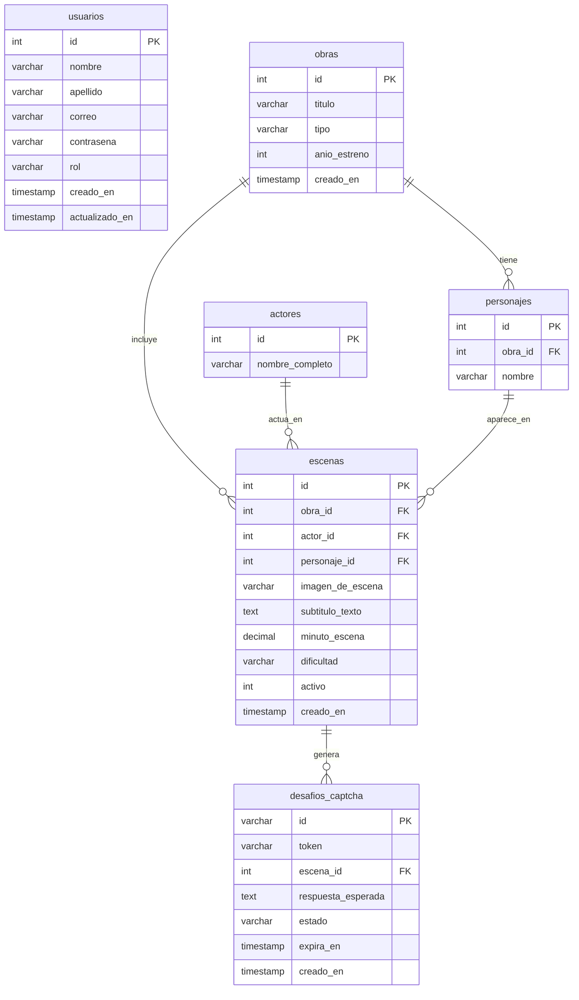

# 📚 Documentación Técnica Integral - API Media

> **Versión de la API:** 1.0.0  
> **Entorno de Ejecución:** Node.js (ES Modules) + Express 5  
> **Base de Datos:** MySQL 8.0+ / MariaDB (vía `mysql2/promise`)  
> **Seguridad:** Encriptación bcrypt (12 salt rounds) + Tokens JWT (HS256) + Control de Acceso Basado en Roles (RBAC)  

---

## 📑 Tabla de Contenidos

1. [Visión General del Proyecto](#-1-visión-general-del-proyecto)
2. [Arquitectura del Software](#-2-arquitectura-del-software)
3. [Modelo de Datos y Base de Datos Relacional](#-3-modelo-de-datos-y-base-de-datos-relacional)
4. [Mecanismos de Seguridad y Autenticación](#-4-mecanismos-de-seguridad-y-autenticación)
5. [Reglas de Validación y Expresiones Regulares (RegEx)](#-5-reglas-de-validación-y-expresiones-regulares-regex)
6. [Referencia Completa de Endpoints](#-6-referencia-completa-de-endpoints)
   - [6.1. GET / - Verificación de Estado](#61-get----verificación-de-estado)
   - [6.2. POST /usuarios - Registro de Usuario](#62-post-usuarios---registro-de-usuario)
   - [6.3. POST /usuarios/login - Inicio de Sesión](#63-post-usuarioslogin---inicio-de-sesión)
   - [6.4. GET /usuarios/perfil - Perfil del Usuario Autenticado](#64-get-usuariosperfil---perfil-del-usuario-autenticado)
   - [6.5. GET /usuarios - Listado General de Usuarios](#65-get-usuarios---listado-general-de-usuarios)
   - [6.6. GET /usuarios/:id - Detalle de Usuario por ID](#66-get-usuariosid---detalle-de-usuario-por-id)
   - [6.7. PUT /usuarios/:id - Actualización de Usuario](#67-put-usuariosid---actualización-de-usuario)
   - [6.8. DELETE /usuarios/:id - Eliminación de Usuario](#68-delete-usuariosid---eliminación-de-usuario)
7. [Códigos de Estado y Manejo de Errores](#-7-códigos-de-estado-y-manejo-de-errores)
8. [Suite de Pruebas Automatizadas](#-8-suite-de-pruebas-automatizadas)
9. [Fases del Proyecto y Roadmap (Fase 2: CAPTCHA Semántico)](#-9-fases-del-proyecto-y-roadmap-fase-2-captcha-semántico)

---

## 🎯 1. Visión General del Proyecto

**API - Media** es una plataforma backend diseñada con un doble propósito:
1. **Fase 1 (Implementada y Activa):** Servir como un robusto subsistema de **Gestión de Usuarios, Autenticación y Autorización RBAC**, con almacenamiento seguro de contraseñas, validación estricta de entradas y emisión de credenciales efímeras mediante JSON Web Tokens.
2. **Fase 2 (En Desarrollo):** Operar como un motor de **CAPTCHA cultural no convencional basado en texto e imágenes**. En lugar de requerir que los usuarios resuelvan acertijos abstractos o lean textos distorsionados, el sistema presenta escenas icónicas del cine, series de televisión y anime con subtítulos incrustados, requiriendo validación semántica contextual para certificar la interacción humana.

---

## 🏗️ 2. Arquitectura del Software

El proyecto implementa el patrón de arquitectura en capas **MVC (Modelo - Vista - Controlador)** adaptado a un servicio REST puro (sin vistas HTML acopladas en runtime).

```
                      ┌─────────────────────────────────────────┐
                      │             Cliente HTTP                │
                      │  (Frontend / Mobile / Postman / cURL)   │
                      └────────────────────┬────────────────────┘
                                           │ Request HTTP
                                           ▼
                      ┌─────────────────────────────────────────┐
                      │              index.js                   │
                      │  (Express App, JSON Parser, Enrutador)  │
                      └────────────────────┬────────────────────┘
                                           │
                        ┌──────────────────┴──────────────────┐
                        ▼                                     ▼
             ┌─────────────────────┐               ┌─────────────────────┐
             │   Ruta Pública /    │               │  /usuarios Router   │
             └─────────────────────┘               └──────────┬──────────┘
                                                              │
                                                              ▼
                                                   ┌─────────────────────┐
                                                   │    Middlewares      │
                                                   │ 1. RegEx Validación │
                                                   │ 2. JWT verificación │
                                                   │ 3. RBAC (soloAdmin) │
                                                   └──────────┬──────────┘
                                                              │
                                                              ▼
                                                   ┌─────────────────────┐
                                                   │ UsuarioController   │
                                                   │ (Lógica de Negocio) │
                                                   └──────────┬──────────┘
                                                              │
                                                              ▼
                                                   ┌─────────────────────┐
                                                   │    Usuario Model    │
                                                   │  (Consultas SQL)    │
                                                   └──────────┬──────────┘
                                                              │
                                                              ▼
                                                   ┌─────────────────────┐
                                                   │    Pool MySQL2      │
                                                   │  (db.js - Conexión) │
                                                   └─────────────────────┘
```

### 📁 Estructura del Árbol de Archivos

```plaintext
API-Media/
├── .env                     # Variables de entorno locales (secretos, DB, JWT)
├── .env.example             # Plantilla documentada de variables requeridas
├── .gitignore               # Exclusiones para git (node_modules, .env, etc.)
├── database.sql             # Script DDL completo y datos de prueba iniciales
├── seed_data.sql            # Script de limpieza y recarga rápida de datos
├── index.js                 # Punto de entrada principal y bootstrap del servidor
├── package.json             # Manifiesto de dependencias y scripts de ejecución
├── package-lock.json        # Árbol de dependencias bloqueado
├── README.md                # Documentación principal del repositorio
├── IMPORTAR_BD.md           # Guía paso a paso para importar en MySQL/XAMPP
├── public/
│   └── imagenes/            # Archivos JPEG de escenas con subtítulos incrustados
├── docs/
│   ├── documentacion.md     # Documentación técnica exhaustiva (este documento)
│   └── openapi.yaml         # Especificación OpenAPI 3.0.3 interactiva
├── src/
│   ├── config/
│   │   └── db.js            # Configuración del Connection Pool de MySQL2
│   ├── controllers/
│   │   ├── Captcha.Controller.js # Lógica de generación y validación de CAPTCHA
│   │   ├── Escena.Controller.js  # Lógica de consulta y catálogo de escenas
│   │   ├── Obra.Controller.js    # Lógica de consulta de obras audiovisuales
│   │   └── Usuario.Controller.js # Lógica de negocio de usuarios y autenticación
│   ├── middlewares/
│   │   ├── auth.js          # Middlewares de verificación de JWT y control RBAC
│   │   └── validar.js       # Validaciones con expresiones regulares (RegEx)
│   ├── models/
│   │   ├── Desafio.model.js # Operaciones sobre la tabla desafios_captcha
│   │   ├── Escena.model.js  # Operaciones y joins de escenas audiovisuales
│   │   ├── Obra.model.js    # Operaciones sobre el catálogo de obras
│   │   └── Usuario.model.js # Abstracción y persistencia de usuarios
│   ├── routes/
│   │   ├── Captcha.Route.js # Endpoints del motor CAPTCHA (/captcha)
│   │   ├── Escena.Route.js  # Endpoints de consulta de escenas (/escenas)
│   │   ├── Obra.Route.js    # Endpoints de consulta de obras (/obras)
│   │   └── Usuario.Route.js # Endpoints de usuarios y autenticación (/usuarios)
│   └── utils/
│       └── jwt.js           # Utilidades para firmado y decodificación de tokens
└── tests/
    ├── captcha.test.js      # Pruebas de integración del motor CAPTCHA
    ├── escenas.test.js      # Pruebas de catálogo de escenas y archivos estáticos
    ├── jwt.test.js          # Pruebas unitarias de firmado y expiración JWT
    └── usuarios.test.js     # Pruebas de integración de endpoints de usuario
```

---

## 🗄️ 3. Modelo de Datos y Base de Datos Relacional

La base de datos relacional `api_media_db` consta de **6 tablas normalizadas** diseñadas para garantizar integridad referencial mediante claves foráneas y restricciones `ON DELETE`:

### 📊 Diagrama Entidad-Relación (Mermaid)



### 📋 Detalle de Tablas y Atributos

#### 1. Tabla `usuarios`
Gestiona las credenciales de acceso y la autorización en el sistema.
* `id` (`INT AUTO_INCREMENT`, **PK**): Identificador numérico secuencial.
* `nombre` (`VARCHAR(100)`, **NOT NULL**): Nombre del usuario.
* `apellido` (`VARCHAR(100)`, **NULL**): Apellido opcional.
* `correo` (`VARCHAR(150)`, **NOT NULL, UNIQUE**): Dirección de correo única para inicio de sesión.
* `contrasena` (`VARCHAR(255)`, **NOT NULL**): Hash de contraseña generado con bcrypt.
* `rol` (`ENUM('admin', 'cliente')`, Default `'cliente'`): Nivel de privilegios RBAC.
* `creado_en` (`TIMESTAMP`, Default `CURRENT_TIMESTAMP`): Fecha de creación.
* `actualizado_en` (`TIMESTAMP`, `ON UPDATE CURRENT_TIMESTAMP`): Última modificación.

#### 2. Tabla `obras`
Almacena las obras audiovisuales de referencia cultural.
* `id` (`INT AUTO_INCREMENT`, **PK**): Identificador de la obra.
* `titulo` (`VARCHAR(150)`, **NOT NULL**): Título comercial de la obra.
* `tipo` (`ENUM('pelicula', 'serie', 'anime')`, **NOT NULL**): Formato de la obra.
* `anio_estreno` (`INT`, **NOT NULL**): Año original de lanzamiento.

#### 3. Tabla `actores`
Registro de actores y actrices de imagen real o actores de voz.
* `id` (`INT AUTO_INCREMENT`, **PK**): Identificador del actor.
* `nombre_completo` (`VARCHAR(150)`, **NOT NULL**): Nombre real del intérprete.

#### 4. Tabla `personajes`
Personajes ficticios pertenecientes a una obra específica.
* `id` (`INT AUTO_INCREMENT`, **PK**): Identificador del personaje.
* `obra_id` (`INT`, **FK** -> `obras.id` `ON DELETE CASCADE`): Obra a la que pertenece.
* `nombre` (`VARCHAR(150)`, **NOT NULL**): Nombre del personaje en la ficción.

#### 5. Tabla `escenas`
Elemento multimedia central del motor CAPTCHA.
* `id` (`INT AUTO_INCREMENT`, **PK**): Identificador de la escena.
* `obra_id` (`INT`, **FK** -> `obras.id` `ON DELETE RESTRICT`): Obra de origen.
* `actor_id` (`INT`, **FK** -> `actores.id` `ON DELETE SET NULL`): Actor que aparece.
* `personaje_id` (`INT`, **FK** -> `personajes.id` `ON DELETE SET NULL`): Personaje involucrado.
* `imagen_de_escena` (`VARCHAR(255)`, **NOT NULL**): Archivo de imagen con subtítulo integrado.
* `subtitulo_texto` (`TEXT`, **NOT NULL**): Transcripción textual del diálogo para comparación semántica.
* `minuto_escena` (`DECIMAL(6,2)`, **NOT NULL**): Marca temporal exacta en el metraje.
* `dificultad` (`ENUM('facil', 'medio', 'dificil')`, Default `'medio'`).
* `activo` (`TINYINT(1)`, Default `1`): Estado de disponibilidad para el desafío.

#### 6. Tabla `desafios_captcha`
Sesiones efímeras de verificación humana generadas para los clientes.
* `id` (`VARCHAR(36)`, **PK**): UUID v4 único del desafío.
* `token` (`VARCHAR(64)`, **NOT NULL, UNIQUE**): Token público entregado al frontend.
* `escena_id` (`INT`, **FK** -> `escenas.id` `ON DELETE CASCADE`): Escena seleccionada.
* `respuesta_esperada` (`TEXT`, **NOT NULL**): Respuesta o palabras clave requeridas.
* `estado` (`ENUM('pendiente', 'resuelto', 'expirado')`, Default `'pendiente'`).
* `expira_en` (`TIMESTAMP`, **NOT NULL**): Plazo límite de validez del reto.

---

## 🔒 4. Mecanismos de Seguridad y Autenticación

### 1. Hash de Contraseñas con `bcrypt`
* **Factor de costo (Salt rounds):** `12`.
* Se aplica hashing asíncrono antes de insertar en la base de datos:
  ```javascript
  const contrasenaHasheada = await bcrypt.hash(contrasena, 12);
  ```
* En el login, se compara mediante `bcrypt.compare(contrasena, usuario.contrasena)`.
* **Regla estricta:** La contraseña nunca se retorna en ninguna respuesta HTTP ni en el payload del JWT.

### 2. Tokens JWT (JSON Web Tokens)
* **Algoritmo:** HMAC-SHA256 (`HS256`).
* **Variables requeridas:** `JWT_SECRET` y `JWT_EXPIRES_IN` (por defecto `2h`).
* **Estructura del Payload:**
  ```json
  {
    "id": 2,
    "correo": "usuario@ejemplo.com",
    "rol": "cliente",
    "iat": 1729450000,
    "exp": 1729457200
  }
  ```
* **Header de Autenticación Requerido:**
  ```http
  Authorization: Bearer <token_jwt>
  ```

### 3. Control de Acceso Basado en Roles (RBAC)
* Middleware `verificarAuth`: Valida presencia, formato y firma del token. Inyecta `req.usuario` con el payload decodificado.
* Middleware `soloAdmin`: Verifica que `req.usuario.rol === "admin"`. Si no lo es, responde con `403 Forbidden`.
* Middleware `permitirRoles(...roles)`: Validador configurable para escenarios multi-rol.

### 4. Prevención de Inyección SQL
Todas las consultas a la base de datos se ejecutan a través de **sentencias preparadas parametrizadas** provistas por `mysql2/promise`:
```javascript
const [rows] = await pool.query(
  "SELECT id, nombre, apellido, correo, rol, creado_en FROM usuarios WHERE id = ?",
  [id]
);
```

---

## 🛡️ 5. Reglas de Validación y Expresiones Regulares (RegEx)

El middleware [validar.js](file:///C:/Users/isft118/Desktop/Software%202do/API-Media/src/middlewares/validar.js) aplica validaciones antes de que cualquier dato llegue a los controladores o la base de datos:

| Campo | Expresión Regular | Descripción / Restricciones |
| :--- | :--- | :--- |
| `nombre` | `^[a-zA-ZáéíóúÁÉÍÓÚñÑüÜ\s]{2,50}$` | Solo letras (incluye acentos, ñ, diéresis) y espacios. De 2 a 50 caracteres. |
| `apellido` | `^[a-zA-ZáéíóúÁÉÍÓÚñÑüÜ\s]{2,50}$` | Opcional. Si se envía, cumple con las mismas reglas de `nombre`. |
| `correo` | `^[a-zA-Z0-9._%+-]+@[a-zA-Z0-9.-]+\.[a-zA-Z]{2,}$` | Formato estándar de email internacional (`nombre@dominio.ext`). |
| `contrasena` | `^(?=.*[a-z])(?=.*[A-Z])(?=.*\d).{8,}$` | Mínimo 8 caracteres, al menos 1 letra mayúscula, 1 minúscula y 1 número. |
| `rol` | Validación de dominio (`['cliente', 'admin']`) | Opcional al registrar. Debe ser exactamente uno de los dos valores válidos. |

---

## 📡 6. Referencia Completa de Endpoints

### 6.1. GET / - Verificación de Estado
Endpoint de bienvenida y comprobación básica de disponibilidad del servidor (*healthcheck*).

* **Método:** `GET`
* **URL:** `/`
* **Acceso:** Público (Sin autenticación)
* **Respuesta Exitosa (`200 OK`):**
  ```json
  {
    "message": "Bienvenido a la API de Media!"
  }
  ```

---

### 6.2. POST /usuarios - Registro de Usuario
Registra un nuevo usuario en la plataforma. Valida los datos con expresiones regulares, comprueba unicidad del correo y hashea la contraseña con bcrypt.

* **Método:** `POST`
* **URL:** `/usuarios`
* **Acceso:** Público
* **Headers:**
  ```http
  Content-Type: application/json
  ```
* **Cuerpo de la Petición (JSON):**
  ```json
  {
    "nombre": "Carlos",
    "apellido": "Gomez",
    "correo": "carlos.gomez@ejemplo.com",
    "contrasena": "ClaveSegura123",
    "rol": "cliente"
  }
  ```
  *(Nota: `apellido` y `rol` son opcionales. `rol` por defecto es `"cliente"`).*

* **Respuesta Exitosa (`201 Created`):**
  ```json
  {
    "message": "Usuario creado con éxito",
    "usuario": {
      "id": 2,
      "nombre": "Carlos",
      "apellido": "Gomez",
      "correo": "carlos.gomez@ejemplo.com",
      "rol": "cliente",
      "creado_en": "2026-10-20T22:30:00.000Z"
    }
  }
  ```

* **Respuestas de Error:**
  * **`400 Bad Request`** - Faltan campos obligatorios:
    ```json
    { "message": "Nombre, correo y contraseña son obligatorios" }
    ```
  * **`400 Bad Request`** - Formato inválido de nombre o apellido:
    ```json
    { "message": "El nombre solo debe contener letras y tener entre 2 y 50 caracteres" }
    ```
  * **`400 Bad Request`** - Formato de correo no válido:
    ```json
    { "message": "El formato del correo electrónico no es válido (ej: usuario@dominio.com)" }
    ```
  * **`400 Bad Request`** - Contraseña no cumple política de seguridad:
    ```json
    { "message": "La contraseña debe tener al menos 8 caracteres, incluir al menos una letra mayúscula, una minúscula y un número" }
    ```
  * **`400 Bad Request`** - Rol no válido:
    ```json
    { "message": "El rol proporcionado no es válido. Debe ser 'cliente' o 'admin'" }
    ```
  * **`409 Conflict`** - Correo duplicado:
    ```json
    { "message": "El correo ya se encuentra registrado" }
    ```

---

### 6.3. POST /usuarios/login - Inicio de Sesión
Autentica las credenciales de un usuario existente. Si son válidas, emite un token JWT con vigencia de 2 horas.

* **Método:** `POST`
* **URL:** `/usuarios/login`
* **Acceso:** Público
* **Headers:**
  ```http
  Content-Type: application/json
  ```
* **Cuerpo de la Petición (JSON):**
  ```json
  {
    "correo": "carlos.gomez@ejemplo.com",
    "contrasena": "ClaveSegura123"
  }
  ```

* **Respuesta Exitosa (`200 OK`):**
  ```json
  {
    "message": "Inicio de sesión exitoso",
    "token": "eyJhbGciOiJIUzI1NiIsInR5cCI6IkpXVCJ9.eyJpZCI6Miw...",
    "usuario": {
      "id": 2,
      "nombre": "Carlos",
      "apellido": "Gomez",
      "correo": "carlos.gomez@ejemplo.com",
      "rol": "cliente",
      "creado_en": "2026-10-20T22:30:00.000Z",
      "actualizado_en": "2026-10-20T22:30:00.000Z"
    }
  }
  ```

* **Respuestas de Error:**
  * **`400 Bad Request`** - Campos vacíos o correo no válido:
    ```json
    { "message": "Correo y contraseña son obligatorios" }
    ```
  * **`401 Unauthorized`** - Credenciales erróneas (correo inexistente o contraseña incorrecta):
    ```json
    { "message": "Credenciales inválidas" }
    ```

---

### 6.4. GET /usuarios/perfil - Perfil del Usuario Autenticado
Retorna la información del usuario en sesión, extrayendo su identidad directamente del token JWT decodificado.

* **Método:** `GET`
* **URL:** `/usuarios/perfil`
* **Acceso:** Requiere Token JWT (`cliente` o `admin`)
* **Headers:**
  ```http
  Authorization: Bearer <token_jwt>
  ```

* **Respuesta Exitosa (`200 OK`):**
  ```json
  {
    "id": 2,
    "nombre": "Carlos",
    "apellido": "Gomez",
    "correo": "carlos.gomez@ejemplo.com",
    "rol": "cliente",
    "creado_en": "2026-10-20T22:30:00.000Z"
  }
  ```

* **Respuestas de Error:**
  * **`401 Unauthorized`** - Token ausente:
    ```json
    { "message": "Token de autenticación no proporcionado" }
    ```
  * **`401 Unauthorized`** - Formato incorrecto del header:
    ```json
    { "message": "Formato de token inválido. Formato esperado: Bearer <token>" }
    ```
  * **`401 Unauthorized`** - Token expirado:
    ```json
    { "message": "Token expirado. Inicie sesión nuevamente" }
    ```
  * **`403 Forbidden`** - Firma inválida o token manipulado:
    ```json
    { "message": "Token inválido o alterado" }
    ```
  * **`404 Not Found`** - El usuario contenido en el token ya no existe en la base de datos:
    ```json
    { "message": "Usuario no encontrado" }
    ```

---

### 6.5. GET /usuarios - Listado General de Usuarios
Obtiene la lista completa de todos los usuarios registrados en el sistema, ordenados por ID de manera ascendente.

* **Método:** `GET`
* **URL:** `/usuarios`
* **Acceso:** Requiere Token JWT (`cliente` o `admin`)
* **Headers:**
  ```http
  Authorization: Bearer <token_jwt>
  ```

* **Respuesta Exitosa (`200 OK`):**
  ```json
  [
    {
      "id": 1,
      "nombre": "Admin",
      "apellido": "Sistema",
      "correo": "admin@apimedia.com",
      "rol": "admin",
      "creado_en": "2026-10-20T20:00:00.000Z"
    },
    {
      "id": 2,
      "nombre": "Carlos",
      "apellido": "Gomez",
      "correo": "carlos.gomez@ejemplo.com",
      "rol": "cliente",
      "creado_en": "2026-10-20T22:30:00.000Z"
    }
  ]
  ```

* **Respuestas de Error:**
  * Las mismas respuestas de autenticación `401 Unauthorized` o `403 Forbidden` documentadas en el endpoint 6.4.

---

### 6.6. GET /usuarios/:id - Detalle de Usuario por ID
Recupera los datos públicos de un usuario específico a través de su identificador numérico.

* **Método:** `GET`
* **URL:** `/usuarios/:id`
* **Acceso:** Requiere Token JWT (`cliente` o `admin`)
* **Headers:**
  ```http
  Authorization: Bearer <token_jwt>
  ```
* **Parámetros de Ruta:**
  * `id` (`integer`, obligatorio): Identificador numérico del usuario (ej: `/usuarios/2`).

* **Respuesta Exitosa (`200 OK`):**
  ```json
  {
    "id": 2,
    "nombre": "Carlos",
    "apellido": "Gomez",
    "correo": "carlos.gomez@ejemplo.com",
    "rol": "cliente",
    "creado_en": "2026-10-20T22:30:00.000Z"
  }
  ```

* **Respuestas de Error:**
  * **`400 Bad Request`** - Parámetro `id` no es un número:
    ```json
    { "message": "El ID proporcionado debe ser un número válido" }
    ```
  * **`404 Not Found`** - No existe usuario con ese identificador:
    ```json
    { "message": "Usuario no encontrado" }
    ```

---

### 6.7. PUT /usuarios/:id - Actualización de Usuario
Actualiza selectivamente los datos generales (`nombre`, `apellido`, `correo`) de un usuario. Solo se modifican los campos enviados en el cuerpo JSON.

* **Método:** `PUT`
* **URL:** `/usuarios/:id`
* **Acceso:** Requiere Token JWT
* **Headers:**
  ```http
  Content-Type: application/json
  Authorization: Bearer <token_jwt>
  ```
* **Parámetros de Ruta:**
  * `id` (`integer`, obligatorio): Identificador numérico del usuario a modificar.

* **Cuerpo de la Petición (JSON):**
  ```json
  {
    "nombre": "Carlos Actualizado",
    "apellido": "Gomez Perez"
  }
  ```

* **Respuesta Exitosa (`200 OK`):**
  ```json
  {
    "message": "Usuario actualizado correctamente",
    "usuario": {
      "id": 2,
      "nombre": "Carlos Actualizado",
      "apellido": "Gomez Perez",
      "correo": "carlos.gomez@ejemplo.com",
      "rol": "cliente",
      "creado_en": "2026-10-20T22:30:00.000Z"
    }
  }
  ```

* **Respuestas de Error:**
  * **`400 Bad Request`** - Cuerpo vacío o sin campos reconocidos:
    ```json
    { "message": "Debe enviar al menos un campo para actualizar" }
    ```
  * **`400 Bad Request`** - Formato RegEx inválido en los datos modificados:
    ```json
    { "message": "El formato del correo electrónico no es válido (ej: usuario@dominio.com)" }
    ```
  * **`404 Not Found`** - Usuario inexistente:
    ```json
    { "message": "Usuario no encontrado" }
    ```
  * **`409 Conflict`** - El nuevo correo ya está registrado por otro usuario:
    ```json
    { "message": "El nuevo correo ya está en uso por otro usuario" }
    ```

---

### 6.8. DELETE /usuarios/:id - Eliminación de Usuario
Elimina permanentemente un usuario de la base de datos. Requiere privilegios estrictos de administrador (`rol: admin`).

* **Método:** `DELETE`
* **URL:** `/usuarios/:id`
* **Acceso:** Requiere Token JWT con **Rol Admin Exclusivo**
* **Headers:**
  ```http
  Authorization: Bearer <token_admin>
  ```
* **Parámetros de Ruta:**
  * `id` (`integer`, obligatorio): Identificador del usuario a suprimir.

* **Respuesta Exitosa (`200 OK`):**
  ```json
  {
    "message": "Usuario eliminado correctamente",
    "usuario": {
      "id": 2,
      "nombre": "Carlos Actualizado",
      "apellido": "Gomez Perez",
      "correo": "carlos.gomez@ejemplo.com",
      "rol": "cliente",
      "creado_en": "2026-10-20T22:30:00.000Z"
    }
  }
  ```

* **Respuestas de Error:**
  * **`401 Unauthorized`** - Sin token de autenticación.
  * **`403 Forbidden`** - Usuario autenticado pero sin rol de administrador:
    ```json
    { "message": "Acceso denegado: se requieren privilegios de administrador" }
    ```
  * **`404 Not Found`** - El usuario con el ID especificado no existe.

---

### 6.9. GET /captcha/nuevo - Generación de Desafío CAPTCHA
Selecciona aleatoriamente una escena audiovisual activa y genera un desafío efímero con vigencia de 10 minutos en la tabla `desafios_captcha`. Retorna al cliente la URL de la escena con subtítulos incrustados y un token único de verificación sin exponer el texto del subtítulo.

* **Método:** `GET`
* **URL:** `/captcha/nuevo`
* **Acceso:** Público
* **Parámetros de Consulta (Opcionales):**
  * `dificultad` (`facil`, `medio`, `dificil`): Filtra el reto por nivel de complejidad.
* **Respuesta Exitosa (`201 Created`):**
  ```json
  {
    "message": "Desafío CAPTCHA generado con éxito",
    "desafio_id": "a1b2c3d4-e5f6-7890-abcd-ef1234567890",
    "token": "tok_9f8a7b6c5d4e3f2a1b0c8d7e6f5a4b3c",
    "imagen_url": "http://localhost:3000/imagenes/matrix_pastilla_azul_roja.jpg",
    "dificultad": "medio",
    "obra": "The Matrix",
    "expira_en": "2026-10-20T23:00:00.000Z",
    "instrucciones": "Escribe el texto del subtítulo visible en la imagen para validar que eres humano."
  }
  ```

---

### 6.10. POST /captcha/validar - Validación de Desafío CAPTCHA
Recibe el token público y la transcripción provista por el usuario. Aplica normalización de caracteres (remueve tildes, mayúsculas, signos tipográficos y espacios redundantes) y ejecuta un cálculo de similitud mediante la distancia de Levenshtein (umbral de aceptación >= 85%) para tolerar deslices ortográficos leves.

* **Método:** `POST`
* **URL:** `/captcha/validar`
* **Acceso:** Público
* **Headers:** `Content-Type: application/json`
* **Cuerpo de la Petición (JSON):**
  ```json
  {
    "token": "tok_9f8a7b6c5d4e3f2a1b0c8d7e6f5a4b3c",
    "respuesta": "toma la pastilla azul y el fin de la historia"
  }
  ```
* **Respuesta Exitosa (`200 OK`):**
  ```json
  {
    "valido": true,
    "message": "Verificación humana exitosa",
    "desafio_id": "a1b2c3d4-e5f6-7890-abcd-ef1234567890",
    "token": "tok_9f8a7b6c5d4e3f2a1b0c8d7e6f5a4b3c"
  }
  ```
* **Respuestas de Error:**
  * **`400 Bad Request`** - Respuesta errónea o discrepante:
    ```json
    {
      "valido": false,
      "message": "La respuesta no coincide con el subtítulo de la escena. Intente nuevamente."
    }
    ```
  * **`400 Bad Request`** - Desafío ya resuelto previamente:
    ```json
    { "valido": false, "message": "Este desafío ya ha sido resuelto anteriormente" }
    ```
  * **`400 Bad Request`** - Desafío vencido por tiempo:
    ```json
    { "valido": false, "message": "El desafío ha expirado. Solicite un nuevo desafío." }
    ```
  * **`404 Not Found`** - Token inexistente:
    ```json
    { "message": "Desafío no encontrado o token inválido" }
    ```

---

### 6.11. GET /escenas - Listado del Catálogo de Escenas
Recupera el listado completo de escenas cinematográficas y televisivas con sus actores, personajes y URL pública de la imagen.

* **Método:** `GET`
* **URL:** `/escenas`
* **Acceso:** Público
* **Parámetros de Consulta (Opcionales):**
  * `obra_id` (`integer`): Filtra escenas pertenecientes a una obra concreta.
  * `dificultad` (`facil`, `medio`, `dificil`): Filtra por dificultad.
* **Respuesta Exitosa (`200 OK`):**
  ```json
  [
    {
      "id": 1,
      "imagen_de_escena": "matrix_pastilla_azul_roja.jpg",
      "imagen_url": "http://localhost:3000/imagenes/matrix_pastilla_azul_roja.jpg",
      "subtitulo_texto": "Toma la pastilla azul y el fin de la historia...",
      "minuto_escena": 28.45,
      "dificultad": "medio",
      "obra_titulo": "The Matrix",
      "actor_nombre": "Laurence Fishburne",
      "personaje_nombre": "Morpheus"
    }
  ]
  ```

---

### 6.12. GET /escenas/:id - Detalle de Escena por ID
* **Método:** `GET`
* **URL:** `/escenas/:id`
* **Acceso:** Público
* **Respuesta Exitosa (`200 OK`):** Retorna el objeto de la escena individual con su `imagen_url`.

---

### 6.13. GET /obras - Catálogo de Obras Audiovisuales
* **Método:** `GET`
* **URL:** `/obras`
* **Acceso:** Público
* **Respuesta Exitosa (`200 OK`):**
  ```json
  [
    {
      "id": 1,
      "titulo": "The Matrix",
      "tipo": "pelicula",
      "anio_estreno": 1999,
      "total_escenas": 1
    }
  ]
  ```

---

### 6.14. GET /obras/:id - Detalle de Obra con Escenas Asociadas
* **Método:** `GET`
* **URL:** `/obras/:id`
* **Acceso:** Público
* **Respuesta Exitosa (`200 OK`):** Objeto de la obra con el arreglo `escenas` anidado.

---

### 6.15. GET /imagenes/:archivo - Servicio de Archivos Estáticos
Servidor de archivos estáticos montado sobre `public/imagenes/`. Entrega directamente la imagen JPEG/PNG con encabezado `Content-Type: image/jpeg`.

---

## 🚦 7. Códigos de Estado y Manejo de Errores

La API sigue rigurosamente las convenciones de la especificación RFC 9110 para códigos de estado HTTP:

| Código | Nombre Estándar | Contexto en API Media |
| :---: | :--- | :--- |
| `200` | **OK** | Operación de lectura, actualización o eliminación ejecutada con éxito. |
| `201` | **Created** | Registro exitoso de un nuevo recurso usuario. |
| `400` | **Bad Request** | Fallo de validación sintáctica (campos faltantes, formato RegEx inválido o ID no numérico). |
| `401` | **Unauthorized** | Error de autenticación: credenciales inválidas en login, token ausente, formato de token incorrecto o token expirado. |
| `403` | **Forbidden** | Autorización denegada: token con firma adulterada o rol insuficiente (ej. intentar eliminar sin rol `admin`). |
| `404` | **Not Found** | El recurso solicitado por ID o ruta no fue hallado. |
| `409` | **Conflict** | Conflicto de unicidad en la base de datos (ej. correo electrónico duplicado). |
| `500` | **Internal Server Error** | Excepción o fallo no controlado en el servidor o pool de conexiones de base de datos. |

---

## 🧪 8. Suite de Pruebas Automatizadas

El proyecto cuenta con una cobertura integral de **47 pruebas automatizadas** divididas en 4 suites ejecutadas mediante **Vitest** y **Supertest**:

```bash
# Ejecutar la suite completa de pruebas (47 tests)
npm test

# Ejecutar pruebas en modo observador interactivo (watch mode)
npm run test:watch
```

### 1. Pruebas Unitarias (`tests/jwt.test.js`) - 7 tests
* Firma correcta de tokens JWT con claims (`id`, `correo`, `rol`).
* Verificación exitosa de payloads válidos.
* Manejo de rechazo ante firmas inválidas o claves alteradas.
* Detección y lanzamiento de excepción ante tokens expirados.

### 2. Pruebas de Integración de Usuarios (`tests/usuarios.test.js`) - 24 tests
* Verificación del endpoint raíz público `GET /`.
* Registro exitoso de usuarios `POST /usuarios` verificando persistencia real en MySQL.
* Validación estricta de RegEx para nombres con caracteres especiales, correos inválidos y contraseñas débiles.
* Comprobación de rechazo de roles no permitidos (`400 Bad Request`).
* Detección de correos duplicados (`409 Conflict`).
* Flujo de inicio de sesión `POST /usuarios/login` y verificación de hash bcrypt.
* Acceso a rutas protegidas con y sin header `Authorization: Bearer <token>`.
* Control de acceso RBAC: rechazo de usuarios regulares en `DELETE /usuarios/:id` y autorización para usuarios `admin`.
* Manejo de IDs inválidos y recursos inexistentes (`404 Not Found`).

### 3. Pruebas de Integración de Escenas y Obras (`tests/escenas.test.js`) - 9 tests
* Listado general de escenas `GET /escenas` con generación dinámica de `imagen_url`.
* Filtrado por nivel de dificultad `GET /escenas?dificultad=facil`.
* Detalle de escena existente `GET /escenas/:id` y manejo de 404 / 400.
* Entrega de archivos estáticos `GET /imagenes/:archivo` con cabecera `Content-Type: image/jpeg`.
* Listado y detalle de obras con escenas anidadas `GET /obras`.
* Manejador global de rutas 404 en formato JSON.

### 4. Pruebas de Integración del Motor CAPTCHA (`tests/captcha.test.js`) - 7 tests
* Generación de desafíos `GET /captcha/nuevo` certificando que el subtítulo esperado no se expone al cliente.
* Validación exitosa `POST /captcha/validar` con tolerancia semántica a mayúsculas y tildes (200 OK).
* Rechazo de desafíos ya resueltos anteriormente (400 Bad Request).
* Rechazo ante respuestas incorrectas que no coinciden con el subtítulo (400 Bad Request).
* Validación de obligatoriedad de campos y tokens inexistentes (404 Not Found).

---

## 🚀 9. Fases del Proyecto y Roadmap

* ✅ **Fase 1 (Completada):** Subsistema de Gestión de Usuarios, Autenticación JWT, Hasheo Bcrypt (12 rondas), RBAC y validaciones RegEx.
* ✅ **Fase 2 (Completada):** Servidor de archivos estáticos multimedia (`public/imagenes/`), catálogo de escenas y obras, y motor completo de generación y validación de desafíos CAPTCHA cultural (`/captcha/nuevo`, `/captcha/validar`).
* 🔮 **Fase 3 (Futura):** Panel de administración en frontend (React / Vue) e integración de biblioteca cliente para inclusión de CAPTCHA mediante un componente web (`<CulturalCaptcha />`).
